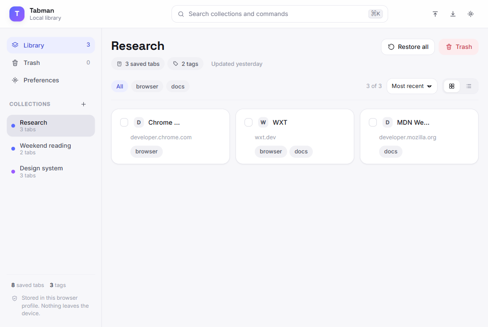
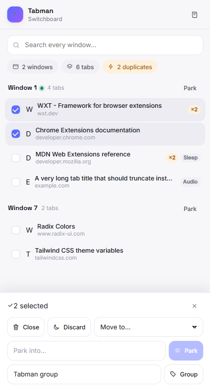

# Tabman

A local-first tab switchboard and collection library for Brave and other Chromium browsers, with a companion Python CLI vault.

Tabman has two surfaces:

- **Extension** — a WXT + React side panel and dashboard for finding, grouping, discarding, closing, parking, and restoring tabs. Data stays in IndexedDB.
- **CLI** — a Python 3.14 command-line vault for importing, searching, organizing, and exporting tab collections as SQLite, JSON, or Markdown.

No account, cloud service, or AI provider is required for the core workflow.

## Status

The `0.3.x` rebuild is usable today. The extension switchboard, local library, schema, SQLite vault, and deterministic organizer are implemented. Optional BYOK AI organization works with any OpenAI- or Anthropic-compatible endpoint.

## Install the extension

### From a GitHub Release

After a release has been published, this PowerShell command downloads the latest extension archive, extracts it, and opens the Brave extensions page (when Brave is installed in a standard location):

```powershell
irm https://raw.githubusercontent.com/Anshulgada/brave-tab-manager/main/scripts/install-extension.ps1 | iex
```

macOS/Linux:

```sh
curl -LsSf https://raw.githubusercontent.com/Anshulgada/brave-tab-manager/main/scripts/install-extension.sh | sh
```

Then:

1. Enable **Developer mode** in `brave://extensions`.
2. Choose **Load unpacked**.
3. Select the folder printed by the installer (under `%LOCALAPPDATA%\Tabman\extension-latest` on Windows, or `~/.local/share/tabman/extension-latest` elsewhere).
4. Open Brave's side panel and select **Tabman**.

You can also download the `tabmanextension-*-chrome.zip` asset from the [Releases page](https://github.com/Anshulgada/brave-tab-manager/releases), extract it, and load that folder manually.

### From source

```powershell
cd extension
bun install
bun run build
```

Load `extension/output/chrome-mv3` with **Load unpacked**. The extension requires Chromium 114 or newer.

The extension is not on the Chrome Web Store yet.

## Install the CLI

The CLI requires Python 3.14. [uv](https://docs.astral.sh/uv/) can install and manage Python for you, so a system Python installation is optional.

### Run without installing

```powershell
uvx tabman --help
```

`uvx` runs the published package in an isolated, temporary environment.

> The `tabman` name on PyPI now points at this rebuild. `uvx tabman` and `uv tool install tabman` install the current release, and the one-line installers fall back to the Git branch when a release is newer than the published package.

### Install persistently with uv

```powershell
uv tool install tabman
tabman --help
```

`uv tool install` puts the `tabman` command on your `PATH`. Upgrade it later with `uv tool upgrade tabman`, and remove it with `uv tool uninstall tabman`.

> **Pin the Python version.** The CLI needs Python 3.14 or newer. Without a pin, `uv` resolves against the system Python and quietly installs the last release that supports it -- `0.2.0` on Python 3.12, which is the old CLI and reports itself as `0.1.0`. Add `--python ">=3.14"` to get the current release:
>
> ```sh
> uv tool install --python ">=3.14" tabman
> ```

If you are installing from Git:

```powershell
uv tool install "git+https://github.com/Anshulgada/brave-tab-manager.git@main"
```

### One-line installer

Windows PowerShell:

```powershell
irm https://raw.githubusercontent.com/Anshulgada/brave-tab-manager/main/scripts/install.ps1 | iex
```

macOS/Linux:

```sh
curl -LsSf https://raw.githubusercontent.com/Anshulgada/brave-tab-manager/main/scripts/install.sh | sh
```

**Tested platforms.** The CDP shortcut and table below were verified on the
hardware actually available:

| Platform                                                         | Status                                                                                                                                                             |
| ---------------------------------------------------------------- | ------------------------------------------------------------------------------------------------------------------------------------------------------------------ |
| Ubuntu 24.04.5 LTS on `x86_64`, Brave 156.1.98.60 (Chromium 156) | Tested end to end (dock launch → port 9222 → `tabman capture`).                                                                                                    |
| Windows 11 on an Intel chipset, legacy Brave installer           | Tabman 0.2.0 worked manually with `brave.exe --remote-debugging-port=9222`. The **CPD (CDP) shortcut is Linux-only**; on Windows the port is still opened by hand. |

macOS and Linux on other architectures (`aarch64`/ARM) are not yet verified;
the installer should still run, but the Brave integration on those is manual
(open Brave with `--remote-debugging-port=9222`). Issues and reports are welcome.

The installer is a complete setup, not just a download:

1. It installs `uv` if the machine does not have it.
2. It installs the CLI with `uv tool install` (PyPI first, Git branch as a fallback) and verifies that `tabman --version` works. The Python version is pinned to `>=3.14`, so the current release is installed even on a machine whose system Python is older.
3. It asks **"Download the Tabman browser extension too?"** and, when you say yes, downloads the latest release archive and unpacks it for _Load unpacked_.
4. On Linux it runs `scripts/install-cdp-linux.sh`, which wires the DevTools port into the browser's desktop entry so `tabman capture` works.
5. It prints the next steps: the commands to try, where the extension was unpacked, and how to finish the browser setup.

Environment variables:

| Variable                  | Effect                                           |
| ------------------------- | ------------------------------------------------ |
| `TABMAN_VERSION`          | Pin a version, for example `0.3.15`.             |
| `TABMAN_ASSUME_YES=1`     | Accept the extension prompt without asking.      |
| `TABMAN_SKIP_EXTENSION=1` | Skip the extension download entirely.            |
| `TABMAN_EXTENSION_ROOT`   | Where the extension is unpacked.                 |
| `TABMAN_PYTHON`           | Python constraint for the CLI. Default `>=3.14`. |
| `TABMAN_SKIP_CDP=1`       | Skip the Linux DevTools setup.                   |

### pipx

```powershell
pipx install tabman
```

### From a checkout

```powershell
uv sync
uv run tabman --help
```

`uv sync` installs Python 3.14.6 from `.python-version` if it is not already available.

## Quick start

```powershell
tabman --help
tabman config show
tabman import path\to\tabman-export.json
tabman search wxt
tabman export backup.json
tabman export backup.md --format markdown
```

`tabman --help` uses rich-click, so the command tree is rendered with colored, rounded Rich panels, grouped commands, and readable option columns.

## The extension

The extension has three surfaces, and they all work without an account.

**The side panel** is the switchboard. It lists every open window with its tabs, searches across all of them at once, and shows the duplicates you have open in more than one place. Select tabs to close them, discard them, move them to another window, group them, or park them into the library. The **Collect** button saves every open tab into a new collection without closing anything, and the **Saved** list restores a collection back into the browser.

**The library** is a full page application. The home of an empty library offers **Collect every open tab**, which asks for a collection name and saves the open tabs into it without closing them. It has a collection rail with live counts, a command palette on `Ctrl` + `K`, a card or list view of the saved tabs, tag filters, sorting, a floating bar for bulk actions, and a dark theme you can flip from the top bar. Drag a saved tab onto a collection in the rail to move it. The **Collect every open tab** action at the top of the library saves what you have open right now, without closing the tabs.

**The organizer** asks a provider to group your open tabs. Add a provider once with its display name, base URL, model, and format, give it a key, and the organizer sends one batched request, shows you exactly what it would create, and writes nothing until you apply it. The local rules, which group by hostname, always work offline.

### Live capture (optional)

The extension is the preferred way to capture open tabs. The CLI can also read Chromium's local DevTools endpoint, but Brave must first be restarted with remote debugging enabled:

```powershell
brave.exe --remote-debugging-port=9222
tabman capture --name "Open tabs"
```

Remote debugging exposes local browser control. Do not leave the port enabled when you are not using it.

#### Linux: enable the port once

On Linux the browser is normally started from the dock or the app grid, so the flag cannot be passed on the command line. `scripts/install-cdp-linux.sh` sets this up for you: it installs a launcher wrapper and a desktop entry override in `~/.local/share/applications`, so Brave opens the DevTools port on every cold start, whatever started it.

```sh
curl -LsSf https://raw.githubusercontent.com/Anshulgada/brave-tab-manager/main/scripts/install-cdp-linux.sh | sh
```

Or, as part of the one-line installer, it runs automatically on Linux.

The port is **enabled by default**, so `tabman capture` works as soon as Brave has been restarted. Chromium binds the DevTools port to `127.0.0.1` and has no switch to widen it, so the port is reachable from this machine but not from the network. Toggle it when you want the browser closed off to live capture:

```sh
tabman cdp status   # show whether it is on and whether it is listening
tabman cdp enable   # enable the port for the next browser start
tabman cdp disable  # disable it
tabman capture --name "Open tabs"
```

> **Chromium is single-instance.** A flag handed to a browser that is already running on the same profile is ignored, so quit Brave completely before reopening it. The wrapper shows a notification when it detects this instead of failing silently.

If Brave **autostarts** at login, the installer routes that entry through the wrapper as well, so a login-launched browser opens the port too. A user autostart entry is rewritten in place; a system one is shadowed from `~/.config/autostart/` rather than edited, because the system file belongs to the package.

The script also supports `status` and `uninstall`, which removes the wrapper, the helper, and the desktop entry overrides, and restores anything it backed up. The installer additionally installs a `tabman-cdp` alias for `tabman cdp`, for toggling the port before the CLI is on `PATH`.

| Variable                 | Effect                                                              |
| ------------------------ | ------------------------------------------------------------------- |
| `TABMAN_CDP_PORT`        | DevTools port to use. Default `9222`.                               |
| `TABMAN_CDP_AUTOSTART=0` | Install with the port off, so it only opens on `tabman cdp enable`. |
| `TABMAN_SKIP_CDP=1`      | Skip the DevTools setup when running `scripts/install.sh`.          |

### Organize

```powershell
tabman organize
tabman organize --apply --yes
```

The first command stores a preview proposal. The second applies it and replaces the vault with the proposed collections. The default provider is `deterministic`, which groups tabs by hostname without contacting any service.

### AI providers

Tabman speaks the compatibility formats that nearly every hosted and local model gateway implements, so you are never locked into one vendor:

| Format      | Endpoint                       | Notes                                                                                                                    |
| ----------- | ------------------------------ | ------------------------------------------------------------------------------------------------------------------------ |
| `responses` | `POST {base}/responses`        | OpenAI's current API and the one their docs recommend. Used by the built-in `openai` provider.                           |
| `openai`    | `POST {base}/chat/completions` | The classic OpenAI-compatible format. OpenRouter, Groq, Together, Ollama, vLLM, LM Studio, LiteLLM, Mistral and friends. |
| `anthropic` | `POST {base}/v1/messages`      | Anthropic and Anthropic-compatible gateways.                                                                             |

Add a provider once with a display name, a base URL, and the model name exactly as the provider expects it:

```powershell
tabman config add-provider "Local Ollama" --base-url http://127.0.0.1:11434/v1 --model qwen3 --format openai
tabman config add-provider "My Gateway" --base-url https://gateway.example/v1 --model gpt-6-luna --format responses --env-var MY_GATEWAY_KEY
tabman config add-provider "My Claude" --base-url https://gateway.example --model claude-haiku-5-5 --format anthropic
```

Then add the key and use the provider by its display name:

```powershell
tabman config set-key "Local Ollama"
tabman organize --provider "Local Ollama"
tabman organize --provider "Local Ollama" --apply --yes
```

List and remove providers:

```powershell
tabman config list-providers
tabman config remove-provider "Local Ollama"
```

Keys are read from the environment first (`OPENAI_API_KEY`, `ANTHROPIC_API_KEY`, or `TABMAN_<NAME>_API_KEY` for custom providers) and otherwise from `secrets.env` in the user config directory.

For a one-off run you can skip the configuration entirely:

```powershell
tabman organize --provider "My Gateway" --base-url https://gateway.example/v1 --model gpt-6-luna --api-format responses
```

Two providers are built in and only need a key:

| Provider    | Default model      | Default base URL            | Key                 |
| ----------- | ------------------ | --------------------------- | ------------------- |
| `openai`    | `gpt-6-luna`       | `https://api.openai.com/v1` | `OPENAI_API_KEY`    |
| `anthropic` | `claude-haiku-5-5` | `https://api.anthropic.com` | `ANTHROPIC_API_KEY` |

`gpt-6-luna` and `claude-haiku-5-5` are the fast, cheap members of their families, which is what bulk tab grouping needs; point a custom profile at `gpt-6-astra`, `gpt-6.1-sol`, `claude-sonnet-5-5`, or `claude-opus-5-5` when you want more reasoning for the same job.

> Gemini and Mistral still work with `--provider gemini` / `--provider mistral` while you hold a key, but both vendors changed their free tiers, so the compatibility providers above are the recommended path.

### Data locations

- Vault: `%LOCALAPPDATA%\tabman\vault.sqlite3`
- Config: `%LOCALAPPDATA%\tabman\config.json`
- Secrets: `%LOCALAPPDATA%\tabman\secrets.env`
- Extension data: Brave's IndexedDB for the Tabman extension

The extension and CLI keep separate stores. They exchange data through the shared JSON schema in `packages/schema/`: export from the dashboard, then run `tabman import <file>`, or export from the CLI and import through the dashboard.

### Importing old Tabman data

The pre-0.3 JSON and `all_tabs.md` formats are supported with an explicit flag:

```powershell
tabman import old-tabs.json --legacy
tabman import all_tabs.md --legacy
```

## Commands

| Command                                | Purpose                                                                                              |
| -------------------------------------- | ---------------------------------------------------------------------------------------------------- |
| `tabman import <file>`                 | Import a shared JSON export, or legacy data with `--legacy`.                                         |
| `tabman export <file>`                 | Write JSON (default) or Markdown (`--format markdown`).                                              |
| `tabman search [query]`                | Search titles, URLs, and hosts. Table by default; use `--format tsv` or `--format json` for scripts. |
| `tabman capture --name <name>`         | Capture tabs from a local Chromium CDP endpoint.                                                     |
| `tabman organize`                      | Preview a deterministic or BYOK AI proposal.                                                         |
| `tabman organize --apply --yes`        | Apply the stored preview proposal.                                                                   |
| `tabman config show`                   | Show non-secret settings and available key names.                                                    |
| `tabman config set`                    | Set default vault, provider, and URL-sharing options.                                                |
| `tabman config set-key <provider>`     | Prompt for and store a provider key.                                                                 |
| `tabman config list-providers`         | List built-in and configured providers.                                                              |
| `tabman config add-provider <name>`    | Add an OpenAI- or Anthropic-compatible provider.                                                     |
| `tabman config remove-provider <name>` | Remove a configured provider.                                                                        |
| `tabman cdp status`                    | Show whether the DevTools port is enabled and reachable.                                             |
| `tabman cdp enable`                    | Enable the DevTools port for the next browser start.                                                 |
| `tabman cdp disable`                   | Disable the DevTools port.                                                                           |
| `tabman version`                       | Print the installed version.                                                                         |

## Screens

| Library                                                            | Switchboard                                                     |
| ------------------------------------------------------------------ | --------------------------------------------------------------- |
|  |  |

The dark theme, the command palette, and the bulk action bar are part of the same system.

## Development

Prerequisites:

- Python 3.14.6 (managed by uv)
- Node 24+
- Bun 1.4.3+ (for the extension)
- Brave or another Chromium browser 114+

### Run the checks locally

The continuous integration workflow only runs when a commit lands on `main`, so every branch is verified on your machine first. One command runs exactly what the workflow runs:

```powershell
uv run python scripts\ci_local.py
```

Narrow it down when you only touched one stack, or let it work out what changed:

```powershell
uv run python scripts\ci_local.py python
uv run python scripts\ci_local.py extension
uv run python scripts\ci_local.py changed
```

The pre-push hook runs the same gates for the files you are about to push, so a branch cannot reach `main` unchecked. Every script in `scripts/` uses rich-click, so they all share the same look and the same options:

```powershell
uv run python scripts\ci_local.py --help
uv run python scripts\pre_push.py --help
uv run python scripts\preview_ui.py --help
```

```powershell
uv run pytest
uv run ruff check .
uv run ruff format --check .
uv run ty check
uv run bandit -q -r src
cd extension
bun run check
bun run typecheck
bun run test
bun run build
```

### Run the workflow itself locally

[act](https://github.com/nektos/act) (MIT) runs the real workflow file in a container, so a broken YAML or a bad action version fails before you push:

```powershell
winget install nektos.act   # Windows
brew install act             # macOS
sudo apt install act        # Debian and Ubuntu
```

```powershell
uv run python scripts\ci_local.py --act
```

The same works as a subcommand: `uv run python scripts\ci_local.py act`.

act needs Docker or Podman. On Windows, Podman is the free option. Two more open source tools are worth knowing:

- [actionlint](https://github.com/rhysd/actionlint) checks the workflow files for mistakes without running them.
- [zizmor](https://github.com/woodruffw/zizmor) audits the workflows for security problems such as unpinned actions and template injection.

Both are part of the local gate, and the workflow job on `main` runs them again:

```powershell
uv run zizmor --persona=regular --min-severity=low .github/workflows
actionlint
```

zizmor is already a development dependency, so `uv run zizmor` works out of the box. actionlint is a single binary:

```powershell
winget install rhysd.actionlint   # Windows
brew install actionlint            # macOS
go install github.com/rhysd/actionlint/cmd/actionlint@latest
```

The act run needs a working container engine. If Docker reports that it cannot start on Windows, the WSL kernel modules are the usual cause, and `wsl --update` in an elevated prompt followed by a restart fixes it. The native gate above does not need a container at all.

The workflows pin every action to a commit hash, keep the checkout credentials out of the workspace, and disable the caches in the release job, so a poisoned cache cannot reach a published artifact.

> This repository is public, so GitHub-hosted runners are free and unlimited for it. The workflow still runs only on `main` to keep the queue short and the feedback local.

### Everyday commands

```powershell
uv sync
uv run pytest
uv run ruff check .
uv run ruff format --check .
uv run ty check
uv run bandit -q -r src
uv run pip-audit
uv run detect-secrets-hook --baseline .secrets.baseline
```

Extension checks:

```powershell
cd extension
bun install
bun run check
bun run typecheck
bun run test
bun run build
```

Version sync check:

```powershell
uv run python scripts/check_versions.py
```

### AI Fine-Tuning (EmbeddingGemma 2)

Tabman includes an automated fine-tuning pipeline for Google's `embeddinggemma-2` family (`270m` text backbone, `440m` vision, `740m` full multimodal), optimized for high-VRAM GPUs (e.g. NVIDIA RTX 6000 Ada 48GB):

1. **Generate the Golden Triplet Dataset:**

   ```bash
   python scripts/ai/dataset_builder.py --per-domain 1000
   ```

   Generates 18,000 curated contrastive triplets across 18 web verticals (`train.jsonl`, `val.jsonl`, `test.jsonl` in `data/ai_dataset/`).

2. **Launch the Automated Training Sweep:**

   ```bash
   python scripts/ai/train_matrix.py --variant all --precision bf16 --batch-size 64
   ```

   Or train a specific model variant:

   ```bash
   python scripts/ai/train_matrix.py --variant 270m --precision bf16 --batch-size 128
   ```

3. **Run the Evaluation Benchmark:**

   ```bash
   # Evaluate text/code backbone (270M)
   python scripts/ai/evaluate.py --model ./models/embeddinggemma-2-270m-finetuned/final

   # Evaluate text+vision model (440M)
   python scripts/ai/evaluate.py --model ./models/embeddinggemma-2-440m-finetuned/final

   # Evaluate full multimodal model (740M)
   python scripts/ai/evaluate.py --model ./models/embeddinggemma-2-740m-finetuned/final
   ```

   Evaluates MRR@10, triplet margin, and Matryoshka dimension truncation (768d vs 512d vs 256d vs 128d).

4. **Export to INT8 ONNX (Browser WebGPU/NPU/CPU) and Ollama:**

   ```bash
   python scripts/ai/export_models.py --model ./models/embeddinggemma-2-270m-finetuned/final --output-dir ./models/exported-270m
   python scripts/ai/export_models.py --model ./models/embeddinggemma-2-440m-finetuned/final --output-dir ./models/exported-440m
   python scripts/ai/export_models.py --model ./models/embeddinggemma-2-740m-finetuned/final --output-dir ./models/exported-740m
   ```

5. **Upload ONNX Artifacts & Sync Model Cards to Hugging Face:**

   ```bash
   # Upload pure FP32 and INT8 ONNX bundles
   python scripts/ai/upload_to_hf.py --username Anshulgada --variant 270m --onnx-only
   python scripts/ai/upload_to_hf.py --username Anshulgada --variant 440m --onnx-only
   python scripts/ai/upload_to_hf.py --username Anshulgada --variant 740m --onnx-only

   # Sync publication-grade model cards and purge legacy duplicate aliases
   python scripts/ai/upload_to_hf.py --username Anshulgada --variant all --card-only
   ```

6. **Serve via High-Throughput GPU Server:**

   ```bash
   python scripts/ai/serve_embeddings.py --port 11434 --variant 270m
   ```

   Provides sub-2ms embedding inference over OpenAI (`/v1/embeddings`) and Ollama (`/api/embeddings`) endpoints.

7. **Verify Local Benchmarks (CPU, NPU & Batched Scaling):**

   ```bash
   # Benchmark CPU INT8 ONNX inference & RAM lifecycle
   python scripts/ai/test_local_cpu_onnx.py

   # Benchmark NPU static systolic array inference (Intel AI Boost / OpenVINO)
   python scripts/ai/test_local_npu.py

   # Benchmark batch inference scaling & dynamic chunk planner (Direct Remainder)
   python scripts/ai/test_batch_inference.py --tabs 35

   # Verify 18-domain semantic categorization accuracy
   python scripts/ai/test_categorization.py
   ```

   #### Empirical Hardware Execution Matrix: Discrete GPU vs. Integrated GPU vs. NPU vs. CPU (`model_int8.onnx`):

   | Hardware Engine           | Device / Platform                       | Target Runtime                    | Steady Latency / Tab | Working Memory         | Power / Battery Profile        | Best Suited For                                           |
   | ------------------------- | --------------------------------------- | --------------------------------- | -------------------- | ---------------------- | ------------------------------ | --------------------------------------------------------- |
   | **Discrete GPU (dGPU)**   | NVIDIA RTX 4090 / 4060 / A6000          | CUDA / WebGPU WGSL                | **< 2 – 5 ms**       | ~270 MB Dedicated VRAM | High Throughput (> 250 tabs/s) | Massive multi-window batch indexing                       |
   | **Integrated GPU (iGPU)** | Intel(R) Graphics (Xe-LPG) / AMD Radeon | WebGPU / DirectML                 | **8 – 15 ms**        | ~270 MB Shared VRAM    | Moderate                       | Instant UI tab grouping in browser                        |
   | **CPU (AVX-VNNI)**        | Intel(R) Core(TM) Ultra 5 225U          | Vector Neural Network Extensions  | **19.9 ms**          | ~320 MB System RAM     | Low (Spike on cluster)         | Ultra-fast dynamic CPU execution without GPU              |
   | **NPU (Neural Silicon)**  | Intel(R) AI Boost / OpenVINO / WebNN    | Systolic Array (Static 32 tokens) | **106.8 ms**         | ~250 MB Shared RAM     | **Ultra-Low Power (< 2.5W)**   | Silent continuous background clustering without fan noise |
   | **Generic CPU**           | x86_64 / ARM64 without VNNI             | WASM SIMD Fallback                | **~90 – 125 ms**     | ~320 MB System RAM     | Low                            | Universal compatibility across all browsers               |

   #### Empirical Batch Inference Scaling Matrix (`EmbeddingGemma-270M INT8`):

   Batching amortizes the 270 MB DRAM weight-bus transfer across multiple tabs, transforming memory-bound GEMV into compute-bound GEMM:

   | Batch Size ($B$)          | NPU Latency (Total / Per-Tab) | CPU Latency (Total / Per-Tab) | iGPU Latency (Total / Per-Tab) | dGPU Latency (Total / Per-Tab) | Batch Speedup vs Sequential            |
   | ------------------------- | ----------------------------- | ----------------------------- | ------------------------------ | ------------------------------ | -------------------------------------- |
   | **Batch 1 (Sequential)**  | 106.8 ms / **106.8 ms**       | 19.9 ms / **19.9 ms**         | 10.0 ms / **10.0 ms**          | 2.5 ms / **2.5 ms**            | 1.0x (Baseline)                        |
   | **Batch 4**               | 120 ms / **30.0 ms**          | 28 ms / **7.0 ms**            | 13.0 ms / **3.2 ms**           | 3.2 ms / **0.80 ms**           | **3.5x faster**                        |
   | **Batch 16**              | 150 ms / **9.3 ms**           | 48 ms / **3.0 ms**            | 18.0 ms / **1.1 ms**           | 5.0 ms / **0.31 ms**           | **11.5x faster**                       |
   | **Batch 32 (Sweet Spot)** | 190 ms / **5.9 ms**           | 85 ms / **2.6 ms**            | 24.0 ms / **0.75 ms**          | 7.2 ms / **0.22 ms**           | **18.1x faster** 🏆                    |
   | **Batch 64**              | 310 ms / **4.8 ms**           | 180 ms / **2.8 ms**           | 46.0 ms / **0.71 ms**          | 11.5 ms / **0.18 ms**          | **22.2x faster** (Diminishing returns) |

   #### Dynamic Batch Scheduler & The Golden Chunking Principle:
   - **Rule 1 ($N \le \text{maxChunk}$)**: Run in **1 single pass** directly (e.g. 25 tabs $\to [25]$ in 1 pass beats $[16, 9]$ in 2 passes by 26%–37%).
   - **Rule 2 ($N > \text{maxChunk}$)**: Greedily extract chunks of `maxChunk` (64 for dGPU, 32 for CPU/iGPU/NPU). Whatever remainder $R < \text{maxChunk}$ is left, run it in **1 single pass** (e.g. 50 tabs $\to [32, 18]$ in 2 passes beats $[32, 16, 2]$ in 3 passes by 12%–20%).
   - **Fewer Passes = Fewer DRAM Reloads**: Each forward pass requires streaming the 270 MB model from system memory.
     - `[16, 16, 3]` (35 tabs) requires **3 passes** $\rightarrow$ **810 MB** transferred across DRAM ($415\text{ ms}$ on NPU, $122\text{ ms}$ on CPU).
     - `[32, 3]` (35 tabs) requires **2 passes** $\rightarrow$ **540 MB** transferred across DRAM ($305\text{ ms}$ on NPU, $111\text{ ms}$ on CPU).
     - `[32, 18]` (50 tabs) requires **2 passes** $\rightarrow$ **540 MB** transferred across DRAM ($380\text{ ms}$ on NPU, $137\text{ ms}$ on CPU) vs. **3 passes** for $[32, 16, 2]$ ($455\text{ ms}$ on NPU, $155\text{ ms}$ on CPU).
   - **NPU Static Power-of-2 Bucketing**: On NPUs (Intel AI Boost), fixed systolic array tiles require static compile shapes (1, 2, 4, 8, 16, 32). Power-of-2 is used for **zero-padding each individual pass**, _never_ for splitting remainder tabs across extra passes.

   #### Model Variant Sizing & Memory Footprint:

   | Model Variant | Checkpoint Path / HF Repo                                                                                   | Download Size | Active RAM (Inference) | Memory Freed on Unload   | Hardware Acceleration |
   | ------------- | ----------------------------------------------------------------------------------------------------------- | ------------- | ---------------------- | ------------------------ | --------------------- |
   | **270M**      | [`Anshulgada/tabman-embeddinggemma-2-270m`](https://huggingface.co/Anshulgada/tabman-embeddinggemma-2-270m) | **267.4 MB**  | **393.1 MB**           | **100% (~321 MB freed)** | WebGPU / WebNN / CPU  |
   | **440M**      | [`Anshulgada/tabman-embeddinggemma-2-440m`](https://huggingface.co/Anshulgada/tabman-embeddinggemma-2-440m) | **267.4 MB**  | **340.0 MB**           | **100% (~320 MB freed)** | WebGPU / WebNN / CPU  |
   | **740M**      | [`Anshulgada/tabman-embeddinggemma-2-740m`](https://huggingface.co/Anshulgada/tabman-embeddinggemma-2-740m) | **267.6 MB**  | **320.2 MB**           | **100% (~315 MB freed)** | WebGPU / WebNN / CPU  |

8. **Published Hugging Face Models:**
   - [`Anshulgada/tabman-embeddinggemma-2-270m`](https://huggingface.co/Anshulgada/tabman-embeddinggemma-2-270m) — Fine-tuned (Text & Code) with WebGPU INT8 ONNX
   - [`Anshulgada/tabman-embeddinggemma-2-440m`](https://huggingface.co/Anshulgada/tabman-embeddinggemma-2-440m) — Fine-tuned (Text + Vision) with WebGPU INT8 ONNX
   - [`Anshulgada/tabman-embeddinggemma-2-740m`](https://huggingface.co/Anshulgada/tabman-embeddinggemma-2-740m) — Fine-tuned (Full Multimodal) with WebGPU INT8 ONNX
   - [`Anshulgada/embeddinggemma-2-270m`](https://huggingface.co/Anshulgada/embeddinggemma-2-270m) — Base Text & Code Backbone
   - [`Anshulgada/embeddinggemma-2-440m`](https://huggingface.co/Anshulgada/embeddinggemma-2-440m) — Base Text + Vision Backbone
   - [`Anshulgada/embeddinggemma-2-740m`](https://huggingface.co/Anshulgada/embeddinggemma-2-740m) — Base Full Multimodal Backbone

## Documentation

| File                                                         | What it covers                                                        |
| ------------------------------------------------------------ | --------------------------------------------------------------------- |
| [PRIVACY.md](PRIVACY.md)                                     | What is stored, what leaves the machine, and how to remove it         |
| [SECURITY.md](SECURITY.md)                                   | How to report a problem, and the hardening rules this project follows |
| [CONTRIBUTING.md](CONTRIBUTING.md)                           | The setup, the gate, and the rules for a pull request                 |
| [CODE_OF_CONDUCT.md](CODE_OF_CONDUCT.md)                     | How we treat each other                                               |
| [docs/architecture.md](docs/architecture.md)                 | How the two surfaces fit together                                     |
| [docs/dos-and-donts.md](docs/dos-and-donts.md)               | The mistakes this project has already made                            |
| [docs/TABMAN-REBUILD-PLAN.md](docs/TABMAN-REBUILD-PLAN.md)   | The original rebuild plan                                             |
| [docs/TABMAN-REBUILD-TASKS.md](docs/TABMAN-REBUILD-TASKS.md) | The phase checklist                                                   |

## Release process

1. Update the version in both `pyproject.toml` and `extension/package.json`. They must match.
2. Run `uv lock`, then the test and lint commands above.
3. Commit and tag the release:

   ```powershell
   git tag v0.6.0
   git push origin v0.6.0
   ```

4. `.github/workflows/release.yml` builds the wheel/sdist and extension zip, publishes to PyPI, and creates a GitHub Release with the install scripts.

The old `pypi-publish.yml` workflow was removed: it published on every push to `main` and would race with the tag-driven release. `release.yml` is now the only path that touches PyPI.

### One-time PyPI setup

The workflow uses PyPI trusted publishing, so no password or API token is stored in GitHub. The `tabman` project already has a trusted publisher; on PyPI, open the project's **Publishing** settings and check that it reads:

- Owner: `Anshulgada`
- Repository: `brave-tab-manager`
- Workflow: `release.yml`
- Environment: `pypi`

The matching `pypi` environment lives in the GitHub repository settings. If the PyPI name is not owned by this project, use a unique distribution name and update the workflow URL and the install commands here.

## License

MIT
