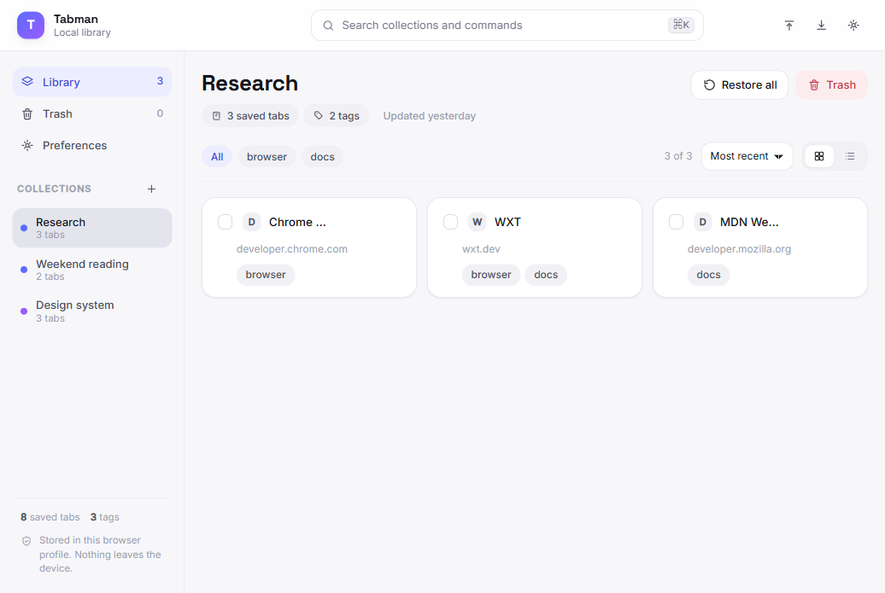
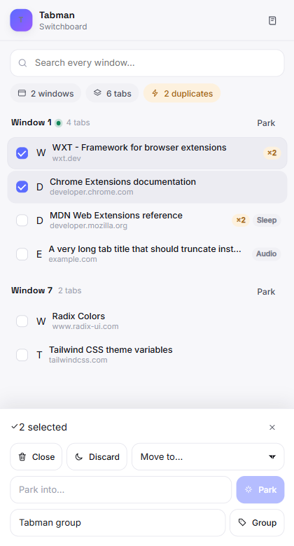

# Tabman

A local-first tab switchboard and collection library for Brave and other Chromium browsers, with a companion Python CLI vault.

Tabman has two surfaces:

- **Extension** — a WXT + React side panel and dashboard for finding, grouping, discarding, closing, parking, and restoring tabs. Data stays in IndexedDB.
- **CLI** — a Python 3.14 command-line vault for importing, searching, organizing, and exporting tab collections as SQLite, JSON, or Markdown.

No account, cloud service, or AI provider is required for the core workflow.

## Status

The `0.3.x` rebuild is usable today. The extension switchboard, local library, schema, SQLite vault, and deterministic organizer are implemented. Optional BYOK AI organization works with any OpenAI- or Anthropic-compatible endpoint.

## Install the extension

### From a GitHub Release

After a release has been published, this PowerShell command downloads the latest extension archive, extracts it, and opens the Brave extensions page (when Brave is installed in a standard location):

```powershell
irm https://raw.githubusercontent.com/Anshulgada/brave-tab-manager/main/scripts/install-extension.ps1 | iex
```

macOS/Linux:

```sh
curl -LsSf https://raw.githubusercontent.com/Anshulgada/brave-tab-manager/main/scripts/install-extension.sh | sh
```

Then:

1. Enable **Developer mode** in `brave://extensions`.
2. Choose **Load unpacked**.
3. Select the folder printed by the installer (under `%LOCALAPPDATA%\Tabman\extension-latest` on Windows, or `~/.local/share/tabman/extension-latest` elsewhere).
4. Open Brave's side panel and select **Tabman**.

You can also download the `tabmanextension-*-chrome.zip` asset from the [Releases page](https://github.com/Anshulgada/brave-tab-manager/releases), extract it, and load that folder manually.

### From source

```powershell
cd extension
bun install
bun run build
```

Load `extension/output/chrome-mv3` with **Load unpacked**. The extension requires Chromium 114 or newer.

The extension is not on the Chrome Web Store yet.

## Install the CLI

The CLI requires Python 3.14. [uv](https://docs.astral.sh/uv/) can install and manage Python for you, so a system Python installation is optional.

### Run without installing

```powershell
uvx tabman --help
```

`uvx` runs the published package in an isolated, temporary environment.

> The `tabman` name on PyPI now points at this rebuild. `uvx tabman` and `uv tool install tabman` install the current release, and the one-line installers fall back to the Git branch when a release is newer than the published package.

### Install persistently with uv

```powershell
uv tool install tabman
tabman --help
```

`uv tool install` puts the `tabman` command on your `PATH`. Upgrade it later with `uv tool upgrade tabman`, and remove it with `uv tool uninstall tabman`.

If you are installing from Git:

```powershell
uv tool install "git+https://github.com/Anshulgada/brave-tab-manager.git@main"
```

### One-line installer

Windows PowerShell:

```powershell
irm https://raw.githubusercontent.com/Anshulgada/brave-tab-manager/main/scripts/install.ps1 | iex
```

macOS/Linux:

```sh
curl -LsSf https://raw.githubusercontent.com/Anshulgada/brave-tab-manager/main/scripts/install.sh | sh
```

The installer is a complete setup, not just a download:

1. It installs `uv` if the machine does not have it.
2. It installs the CLI with `uv tool install` (PyPI first, Git branch as a fallback) and verifies that `tabman --version` works.
3. It asks **"Download the Tabman browser extension too?"** and, when you say yes, downloads the latest release archive and unpacks it for _Load unpacked_.
4. It prints the next steps: the commands to try, where the extension was unpacked, and how to finish the browser setup.

Environment variables:

| Variable                  | Effect                                      |
| ------------------------- | ------------------------------------------- |
| `TABMAN_VERSION`          | Pin a version, for example `0.3.15`.        |
| `TABMAN_ASSUME_YES=1`     | Accept the extension prompt without asking. |
| `TABMAN_SKIP_EXTENSION=1` | Skip the extension download entirely.       |
| `TABMAN_EXTENSION_ROOT`   | Where the extension is unpacked.            |

### pipx

```powershell
pipx install tabman
```

### From a checkout

```powershell
uv sync
uv run tabman --help
```

`uv sync` installs Python 3.14.6 from `.python-version` if it is not already available.

## Quick start

```powershell
tabman --help
tabman config show
tabman import path\to\tabman-export.json
tabman search wxt
tabman export backup.json
tabman export backup.md --format markdown
```

`tabman --help` uses rich-click, so the command tree is rendered with colored, rounded Rich panels, grouped commands, and readable option columns.

### Live capture (optional)

The extension is the preferred way to capture open tabs. The CLI can also read Chromium's local DevTools endpoint, but Brave must first be restarted with remote debugging enabled:

```powershell
brave.exe --remote-debugging-port=9222
tabman capture --name "Open tabs"
```

Remote debugging exposes local browser control. Do not leave the port enabled when you are not using it.

### Organize

```powershell
tabman organize
tabman organize --apply --yes
```

The first command stores a preview proposal. The second applies it and replaces the vault with the proposed collections. The default provider is `deterministic`, which groups tabs by hostname without contacting any service.

### AI providers

Tabman speaks the compatibility formats that nearly every hosted and local model gateway implements, so you are never locked into one vendor:

| Format      | Endpoint                       | Notes                                                                                                                  |
| ----------- | ------------------------------ | ---------------------------------------------------------------------------------------------------------------------- |
| `responses` | `POST {base}/responses`        | OpenAI's current API and the one their docs recommend. Used by the built-in `openai` provider.                            |
| `openai`    | `POST {base}/chat/completions` | The classic OpenAI-compatible format. OpenRouter, Groq, Together, Ollama, vLLM, LM Studio, LiteLLM, Mistral and friends. |
| `anthropic` | `POST {base}/v1/messages`      | Anthropic and Anthropic-compatible gateways.                                                                            |

Add a provider once with a display name, a base URL, and the model name exactly as the provider expects it:

```powershell
tabman config add-provider "Local Ollama" --base-url http://127.0.0.1:11434/v1 --model qwen3 --format openai
tabman config add-provider "My Gateway" --base-url https://gateway.example/v1 --model gpt-6-luna --format responses --env-var MY_GATEWAY_KEY
tabman config add-provider "My Claude" --base-url https://gateway.example --model claude-haiku-5-5 --format anthropic
```

Then add the key and use the provider by its display name:

```powershell
tabman config set-key "Local Ollama"
tabman organize --provider "Local Ollama"
tabman organize --provider "Local Ollama" --apply --yes
```

List and remove providers:

```powershell
tabman config list-providers
tabman config remove-provider "Local Ollama"
```

Keys are read from the environment first (`OPENAI_API_KEY`, `ANTHROPIC_API_KEY`, or `TABMAN_<NAME>_API_KEY` for custom providers) and otherwise from `secrets.env` in the user config directory.

For a one-off run you can skip the configuration entirely:

```powershell
tabman organize --provider "My Gateway" --base-url https://gateway.example/v1 --model gpt-6-luna --api-format responses
```

Two providers are built in and only need a key:

| Provider    | Default model      | Default base URL            | Key                |
| ----------- | ------------------ | --------------------------- | ------------------ |
| `openai`    | `gpt-6-luna`       | `https://api.openai.com/v1` | `OPENAI_API_KEY`   |
| `anthropic` | `claude-haiku-5-5` | `https://api.anthropic.com` | `ANTHROPIC_API_KEY` |

`gpt-6-luna` and `claude-haiku-5-5` are the fast, cheap members of their families, which is what bulk tab grouping needs; point a custom profile at `gpt-6-astra`, `gpt-6.1-sol`, `claude-sonnet-5-5`, or `claude-opus-5-5` when you want more reasoning for the same job.

> Gemini and Mistral still work with `--provider gemini` / `--provider mistral` while you hold a key, but both vendors changed their free tiers, so the compatibility providers above are the recommended path.

### Data locations

- Vault: `%LOCALAPPDATA%\tabman\vault.sqlite3`
- Config: `%LOCALAPPDATA%\tabman\config.json`
- Secrets: `%LOCALAPPDATA%\tabman\secrets.env`
- Extension data: Brave's IndexedDB for the Tabman extension

The extension and CLI keep separate stores. They exchange data through the shared JSON schema in `packages/schema/`: export from the dashboard, then run `tabman import <file>`, or export from the CLI and import through the dashboard.

### Importing old Tabman data

The pre-0.3 JSON and `all_tabs.md` formats are supported with an explicit flag:

```powershell
tabman import old-tabs.json --legacy
tabman import all_tabs.md --legacy
```

## Commands

| Command                                | Purpose                                                                                              |
| -------------------------------------- | ---------------------------------------------------------------------------------------------------- |
| `tabman import <file>`                 | Import a shared JSON export, or legacy data with `--legacy`.                                         |
| `tabman export <file>`                 | Write JSON (default) or Markdown (`--format markdown`).                                              |
| `tabman search [query]`                | Search titles, URLs, and hosts. Table by default; use `--format tsv` or `--format json` for scripts. |
| `tabman capture --name <name>`         | Capture tabs from a local Chromium CDP endpoint.                                                     |
| `tabman organize`                      | Preview a deterministic or BYOK AI proposal.                                                         |
| `tabman organize --apply --yes`        | Apply the stored preview proposal.                                                                   |
| `tabman config show`                   | Show non-secret settings and available key names.                                                    |
| `tabman config set`                    | Set default vault, provider, and URL-sharing options.                                                |
| `tabman config set-key <provider>`     | Prompt for and store a provider key.                                                                 |
| `tabman config list-providers`         | List built-in and configured providers.                                                              |
| `tabman config add-provider <name>`    | Add an OpenAI- or Anthropic-compatible provider.                                                     |
| `tabman config remove-provider <name>` | Remove a configured provider.                                                                        |
| `tabman version`                       | Print the installed version.                                                                         |

## Screens

| Library | Switchboard |
| --- | --- |
|  |  |

The dark theme, the command palette, and the bulk action bar are part of the same system.

## Development

Prerequisites:

- Python 3.14.6 (managed by uv)
- Node 24+
- Bun 1.4.3+ (for the extension)
- Brave or another Chromium browser 114+

### Run the checks locally

The continuous integration workflow only runs when a commit lands on `main`, so every branch is verified on your machine first. One command runs exactly what the workflow runs:

```powershell
uv run python scripts\ci_local.py
```

Narrow it down when you only touched one stack, or let it work out what changed:

```powershell
uv run python scripts\ci_local.py python
uv run python scripts\ci_local.py extension
uv run python scripts\ci_local.py changed
```

The pre-push hook runs the same gates for the files you are about to push, so a branch cannot reach `main` unchecked. Every script in `scripts/` uses rich-click, so they all share the same look and the same options:

```powershell
uv run python scripts\ci_local.py --help
uv run python scripts\pre_push.py --help
uv run python scripts\preview_ui.py --help
```

```powershell
uv run pytest
uv run ruff check .
uv run ruff format --check .
uv run ty check
uv run bandit -q -r src
cd extension
bun run check
bun run typecheck
bun run test
bun run build
```

### Run the workflow itself locally

[act](https://github.com/nektos/act) (MIT) runs the real workflow file in a container, so a broken YAML or a bad action version fails before you push:

```powershell
winget install nektos.act   # Windows
brew install act             # macOS
sudo apt install act        # Debian and Ubuntu
```

```powershell
uv run python scripts\ci_local.py --act
```

The same works as a subcommand: `uv run python scripts\ci_local.py act`.

act needs Docker or Podman. On Windows, Podman is the free option. Two more open source tools are worth knowing:

- [actionlint](https://github.com/rhysd/actionlint) checks the workflow files for mistakes without running them.
- [zizmor](https://github.com/woodruffw/zizmor) audits the workflows for security problems such as unpinned actions and template injection.

Both are part of the local gate, and the workflow job on `main` runs them again:

```powershell
uv run zizmor --persona=regular --min-severity=low .github/workflows
actionlint
```

zizmor is already a development dependency, so `uv run zizmor` works out of the box. actionlint is a single binary:

```powershell
winget install rhysd.actionlint   # Windows
brew install actionlint            # macOS
go install github.com/rhysd/actionlint/cmd/actionlint@latest
```

The workflows pin every action to a commit hash, keep the checkout credentials out of the workspace, and disable the caches in the release job, so a poisoned cache cannot reach a published artifact.

> This repository is public, so GitHub-hosted runners are free and unlimited for it. The workflow still runs only on `main` to keep the queue short and the feedback local.

### Everyday commands

```powershell
uv sync
uv run pytest
uv run ruff check .
uv run ruff format --check .
uv run ty check
uv run bandit -q -r src
```

Extension checks:

```powershell
cd extension
bun install
bun run check
bun run typecheck
bun run test
bun run build
```

Version sync check:

```powershell
uv run python scripts/check_versions.py
```

## Release process

1. Update the version in both `pyproject.toml` and `extension/package.json`. They must match.
2. Run `uv lock`, then the test and lint commands above.
3. Commit and tag the release:

   ```powershell
   git tag v0.3.16
   git push origin v0.3.16
   ```

4. `.github/workflows/release.yml` builds the wheel/sdist and extension zip, publishes to PyPI, and creates a GitHub Release with the install scripts.

The old `pypi-publish.yml` workflow was removed: it published on every push to `main` and would race with the tag-driven release. `release.yml` is now the only path that touches PyPI.

### One-time PyPI setup

The workflow uses PyPI trusted publishing, so no password or API token is stored in GitHub. The `tabman` project already has a trusted publisher; on PyPI, open the project's **Publishing** settings and check that it reads:

- Owner: `Anshulgada`
- Repository: `brave-tab-manager`
- Workflow: `release.yml`
- Environment: `pypi`

The matching `pypi` environment lives in the GitHub repository settings. If the PyPI name is not owned by this project, use a unique distribution name and update the workflow URL and the install commands here.

## License

MIT
