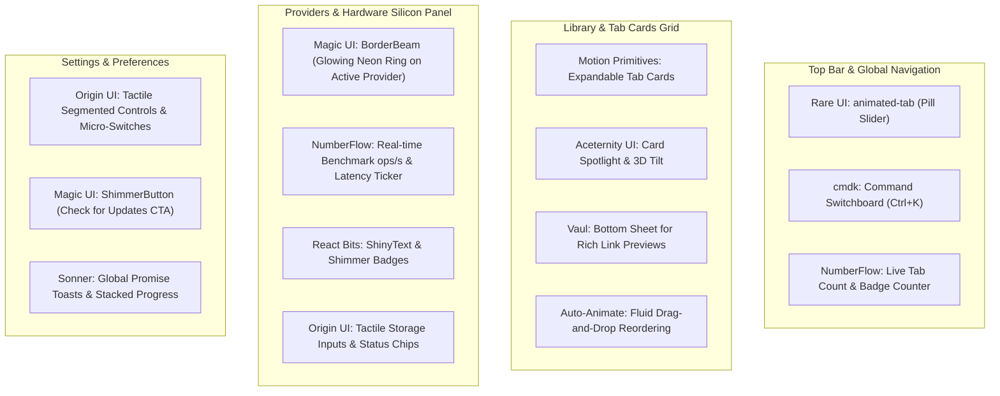

# Tabman Design System & Component Library: Monster UI Transformation Plan

This document establishes the comprehensive technical blueprint to elevate Tabman's extension dashboard and side panel from functional, fragmented styling into an award-winning, fluid, "monster" design system.

---

## 1. Executive Vision & Core Philosophy

Instead of writing custom ad-hoc CSS files (`base.css`, `cards.css`, `organize.css`, `settings.css`) and littering React components with manual inline `style={{ ... }}` objects, Tabman is adopting a **Composable Atomic Architecture**:

1. **Zero Ad-Hoc CSS:** All layout, spacing, typography, and colors are defined through strict Tailwind CSS design tokens and semantic CSS variables.
2. **Headless Accessible Primitives:** Built on **Radix UI** and **cmdk** to guarantee complete ARIA accessibility, focus trapping, and keyboard navigation.
3. **World-Class Micro-Interactions:** Infused with the best interactive patterns from **Rare UI**, **Aceternity UI**, **Magic UI**, **21st.dev**, **Motion Primitives**, **Origin UI**, and **React Bits**.
4. **Fluid Motion Physics:** Powered by **Motion (Framer Motion)** springs, shared layout IDs, and **NumberFlow** morphing numeric counters.
5. **Centralized Feedback:** Replaced all scattered `onNotify` banners with **Sonner** stacked toast pipelines.

---

## 2. The Monster UI Arsenal (Curated Reference Matrix)

| Category                         | Library / Resource    | Reference URL                                | Specific Role in Tabman                                                                                        |
| -------------------------------- | --------------------- | -------------------------------------------- | -------------------------------------------------------------------------------------------------------------- |
| **Foundation Primitives**        | **shadcn/ui**         | `https://ui.shadcn.com/`                     | Core headless components: `Button`, `Card`, `Badge`, `Dialog`, `Switch`, `Slider`, `Tooltip`, `Popover`.       |
| **Command Switchboard**          | **cmdk**              | `https://github.com/pacocoursey/cmdk`        | High-speed, keyboard-driven `Ctrl+K` palette for live tab switching, parking, and fuzzy search.                |
| **Animated Tabs & Navigation**   | **Rare UI**           | `https://rareui.in/`                         | `animated-tab` with fluid spring pill slider for window selector, theme toggle, and panel navigation.          |
| **Visual Accents & Depth**       | **Aceternity UI**     | `https://ui.aceternity.com/`                 | `CardSpotlight`, `3D-Pin`, `BackgroundBeams`, and `GlowingStars` for hardware engines and model cards.         |
| **Motion Primitives**            | **Motion Primitives** | `https://motion-primitives.com/`             | Morphing dialogs, expandable tab cards, smooth text morphing, and fluid spring popovers.                       |
| **Form & Input Interactions**    | **Origin UI**         | `https://originui.com/`                      | Tactile switches, segmented controls, custom slider handles, and copyable input fields.                        |
| **Micro-Interactions & Shaders** | **React Bits**        | `https://reactbits.dev/`                     | Split-text animations, iridescent hover highlights, and interactive physics cards.                             |
| **Motion Effects & Bento**       | **Magic UI**          | `https://magicui.design/`                    | `BorderBeam` on active AI provider, `ShimmerButton` on AI Organize, and `BentoGrid` collection showcases.      |
| **Fluid Numeric Transitions**    | **NumberFlow**        | `https://number-flow.barvian.me/`            | Ultra-smooth morphing numbers for live tab counts, memory sizes, latency benchmarks, and ops/sec.              |
| **Notifications & Toasts**       | **Sonner**            | `https://sonner.emilkowal.ski/`              | Stacked, non-blocking toast engine supporting `toast.promise` for hardware benchmarks and sidecar model scans. |
| **Drawers & Sheets**             | **Vaul**              | `https://vaul.emilkowal.ski/`                | Fluid iOS-style drawer / sheet for tab link preview inspection and rich metadata details.                      |
| **Tactile Buttons & Cursors**    | **Hover.dev**         | `https://hover.dev/`                         | Magnetic action buttons, 3D card tilt physics, and responsive hover highlights.                                |
| **Community Registry**           | **21st.dev**          | `https://21st.dev/`                          | "The npm for Design Engineers" — curated shadcn-compatible components and modern UI blocks.                    |
| **Curated Aesthetics**           | **Beautiful UI**      | `https://www.beautifului.dev/`               | Minimalist tactile surfaces, micro-borders, and high-craft elevation.                                          |
| **Design Inspiration MCP**       | **Awwwards-mcp**      | `https://github.com/INSANE0777/Awwwards-mcp` | Direct agent integration to inspect award-winning web design systems, color harmonies, and layout patterns.    |
| **Creative Shaders**             | **Genjutsu**          | `https://github.com/AThevon/genjutsu`        | Modern micro-interactions, glassmorphism shaders, and fluid tab switchers.                                     |

---

## 3. Screen-by-Screen Component Mapping



### Detailed Feature Enhancements:

#### 1. Top Bar & Window Switchboard

- **Animated Window Selector (`rare-ui/animated-tab`):** Replaces static buttons with a spring-physics sliding background pill that glides seamlessly between _All Windows_, _Window 1_, _Window 2_, and _Saved Collections_.
- **Command Palette (`cmdk`):** Instant spotlight modal triggered via `Ctrl+K` / `Cmd+K`. Allows fuzzy searching tabs with real-time WASM scores, instant duplicate closing, and one-key parking.
- **Dynamic Tab Counter (`number-flow`):** As tabs open, close, or deduplicate, numbers smoothly roll and morph instead of abruptly jumping.

#### 2. Library & Tab Cards

- **Tactile Card Hover (`aceternity/card-spotlight` + `hover.dev/tilt`):** Moving the cursor across a tab card produces a subtle radial highlight that follows the pointer with glassmorphic depth.
- **Rich Preview Drawer (`vaul`):** Clicking a preview cover glides up an accessible bottom sheet with full OpenGraph cover imagery, site favicons, author metadata, and action buttons.
- **Smooth Layout Transitions (`framer-motion/layout`):** Filtering by tags or deleting tabs causes surrounding cards to glide effortlessly into their new grid coordinates without jarring layout shifts.

#### 3. Providers & Hardware Silicon Acceleration

- **Active Silicon Halo (`magicui/border-beam`):** The currently selected AI provider and recommended hardware device feature a fluid, moving beam of violet/emerald light running along their border.
- **Live Empirical Benchmark Ticker (`number-flow`):** When running `Benchmark Hardware`, the operations/second display rapidly rolls through values to the final empirical score (`2,420,119 ops/s`).
- **Disk Storage Status (`origin-ui/status-badge`):** Clear, honest badges (_Model Cached on Disk_ vs. _Ready on First Use_) featuring animated pulsing indicators.

#### 4. Settings & Global Notifications

- **Unified Segmented Controls:** Theme (_System_, _Light_, _Dark_), Default View (_Grid_, _List_), and Organize Destination (_Single_, _Separate_) share a single, bulletproof `<SegmentedControl />` primitive.
- **Centralized Toaster (`sonner`):** Toast alerts stack neatly in the bottom-right corner. Long operations show interactive progress (`toast.promise(runBenchmark(), { loading: 'Benchmarking GPU/NPU silicon...', success: 'Benchmark complete!', error: 'Benchmark failed' })`).
- **Primary Action Shimmer (`magicui/shimmer-button`):** High-value CTA buttons like _"Organize with AI"_ and _"Check for Updates"_ feature subtle ambient shimmer animations.

---

## 4. Design Tokens & Theme Specification

All colors, radiuses, and shadows are centralized in semantic CSS variables in `base.css` and mapped into `tailwind.config.ts`:

```typescript
// tailwind.config.ts
import type { Config } from "tailwindcss";

export default {
  darkMode: ["class", '[data-theme="dark"]'],
  content: ["./entrypoints/**/*.{html,ts,tsx}", "./src/**/*.{ts,tsx}"],
  theme: {
    extend: {
      colors: {
        background: "hsl(var(--background))",
        foreground: "hsl(var(--foreground))",
        card: {
          DEFAULT: "hsl(var(--card))",
          foreground: "hsl(var(--card-foreground))",
        },
        popover: {
          DEFAULT: "hsl(var(--popover))",
          foreground: "hsl(var(--popover-foreground))",
        },
        primary: {
          DEFAULT: "hsl(var(--primary))",
          foreground: "hsl(var(--primary-foreground))",
        },
        secondary: {
          DEFAULT: "hsl(var(--secondary))",
          foreground: "hsl(var(--secondary-foreground))",
        },
        muted: {
          DEFAULT: "hsl(var(--muted))",
          foreground: "hsl(var(--muted-foreground))",
        },
        accent: {
          DEFAULT: "hsl(var(--accent))",
          foreground: "hsl(var(--accent-foreground))",
        },
        destructive: {
          DEFAULT: "hsl(var(--destructive))",
          foreground: "hsl(var(--destructive-foreground))",
        },
        border: "hsl(var(--border))",
        input: "hsl(var(--input))",
        ring: "hsl(var(--ring))",
      },
      borderRadius: {
        lg: "var(--radius)",
        md: "calc(var(--radius) - 2px)",
        sm: "calc(var(--radius) - 4px)",
      },
      animation: {
        "border-beam": "border-beam calc(var(--duration)*1s) infinite linear",
        shimmer: "shimmer 2s linear infinite",
      },
    },
  },
  plugins: [],
} satisfies Config;
```

---

## 5. Architectural Directory Layout

```
extension/src/
├── components/
│   ├── ui/                        # Atomic Headless Primitives (shadcn/ui + Radix)
│   │   ├── badge.tsx              # Standardized status badges & chips
│   │   ├── button.tsx             # Variant-based button (default, outline, ghost, icon)
│   │   ├── card.tsx               # Card, CardHeader, CardTitle, CardContent, CardFooter
│   │   ├── command.tsx            # cmdk-backed spotlight command palette
│   │   ├── dialog.tsx             # Radix dialog with focus-trap and blur backdrop
│   │   ├── input.tsx              # Form and search inputs with clear/copy actions
│   │   ├── popover.tsx            # Radix floating popover
│   │   ├── scroll-area.tsx        # Custom smooth scroll container
│   │   ├── segmented-control.tsx  # Rare UI animated sliding pill tabs
│   │   ├── slider.tsx             # Radix slider with step markers
│   │   ├── switch.tsx             # Smooth animated toggle switch
│   │   ├── tooltip.tsx            # Radix viewport-safe floating tooltip
│   │   └── toaster.tsx            # Sonner global toast provider
│   │
│   ├── motion/                    # High-End Visual Effects (Magic UI, Aceternity, NumberFlow)
│   │   ├── animated-tab.tsx       # Rare UI fluid tab navigation
│   │   ├── border-beam.tsx        # Magic UI traveling neon border glow
│   │   ├── card-spotlight.tsx     # Aceternity mouse-following radial spotlight
│   │   ├── number-flow.tsx        # Barvian NumberFlow rolling digit morpher
│   │   ├── shimmer-button.tsx     # Magic UI glowing CTA button
│   │   └── shiny-text.tsx         # Subtle gradient text shimmer
│   │
│   └── composite/                 # Feature-Specific Unified Blocks
│       ├── TabCard.tsx            # Visual tab card with link previews & tags
│       ├── HardwareBenchmark.tsx  # Multi-device ops/sec monitor with live ticker
│       ├── ModelSelector.tsx      # Hugging Face local ONNX models grid
│       ├── ProviderConfig.tsx     # OpenAI/Anthropic/Local endpoint card
│       └── TopbarNavigation.tsx   # Window switchboard & global action bar
```

---

## 6. Phased Implementation & Migration Roadmap

### Phase 1: Tooling, Tokens & Core Primitives

1. **Tooling Setup:** Install Tailwind CSS, PostCSS, Radix UI packages, `cmdk`, `sonner`, `@number-flow/react`, `clsx`, and `tailwind-merge`.
2. **WXT Pipeline:** Ensure Tailwind processes during `wxt build` with full hot reloading.
3. **Primitives Implementation:** Build `button.tsx`, `card.tsx`, `badge.tsx`, `tooltip.tsx`, `dialog.tsx`, and `segmented-control.tsx`.
4. **Toast Migration:** Mount Sonner `<Toaster />` in `App.tsx` and migrate all panels away from `onNotify`.

### Phase 2: Micro-Interactions & Motion Integration

1. **Animated Navigation:** Integrate `Rare UI`'s `animated-tab` into the Topbar window switchboard and Settings segmented controls.
2. **Rolling Number Counters:** Wire `NumberFlow` into the tab counters, collection counts, benchmark ops/sec, and memory badges.
3. **Active Silicon Highlights:** Apply `BorderBeam` to active AI providers and recommended hardware engines.
4. **Command Palette:** Rebuild `Ctrl+K` with `cmdk` for lightning-fast tab navigation.

### Phase 3: Panel-by-Panel Refactoring

1. **Settings Panel:** Replace `.settings-card` and legacy CSS with new `<Card>`, `<Switch>`, and `<SegmentedControl>` components.
2. **Providers Panel:** Refactor Hugging Face model cards, path inputs, and benchmark results strip using unified card spotlights and badges.
3. **Organize & Rules Panels:** Standardize rule lists and AI proposal cards with motion layout transitions.
4. **Home & Collections:** Implement tactile card spotlights and bottom sheet preview drawers.

### Phase 4: CSS Cleanup & Deprecation

1. Incrementally delete `organize.css`, `settings.css`, `cards.css`, and `topbar.css`.
2. Consolidate shared CSS variables into a clean, unified `theme.css`.
3. Verify zero bundle bloat and ensure total extension output remains lightweight (< 3.5 MB).

---

## 7. Quality Gates & Non-Negotiable Standards

- **Zero Business Logic Regressions:** Database schemas (Dexie), Rust WASM SIMD kernels, native sidecar protocols, and Iframely link preview persistence must remain 100% operational.
- **Strict Test Coverage:** All 163 Vitest tests and 143 Pytest tests must pass on every stage.
- **Accessibility (a11y):** Full keyboard navigability (`Tab`, `Enter`, `Space`, `Esc`, `Arrows`), high-contrast focus rings, and screen-reader ARIA semantics.
- **Performance:** 60 FPS fluid micro-interactions with zero layout thrashing or V8 garbage collection stutter.
