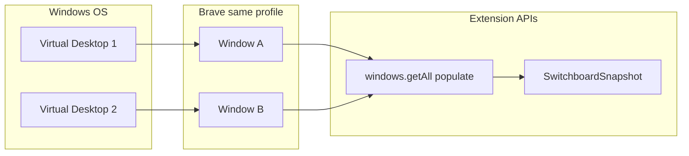
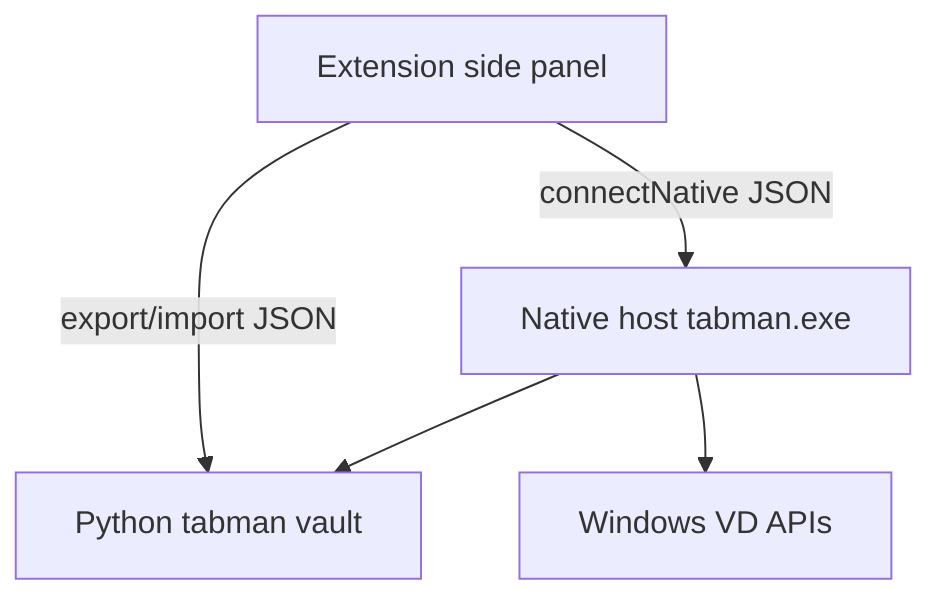
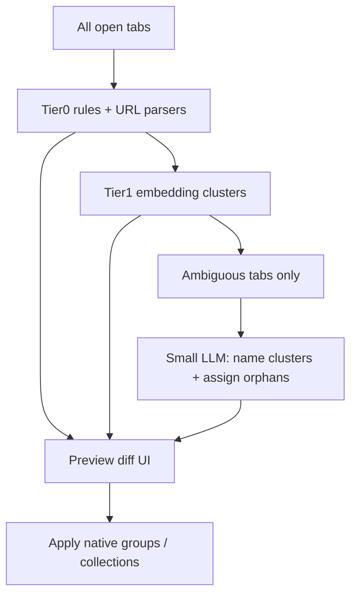
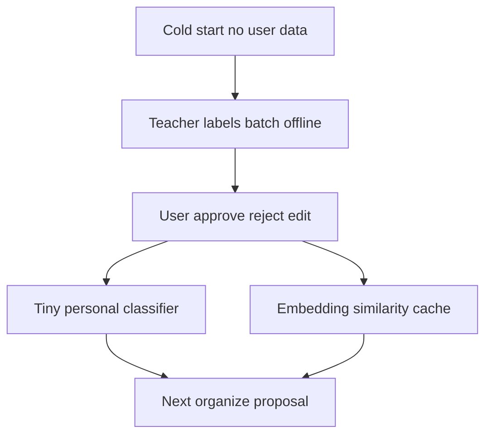
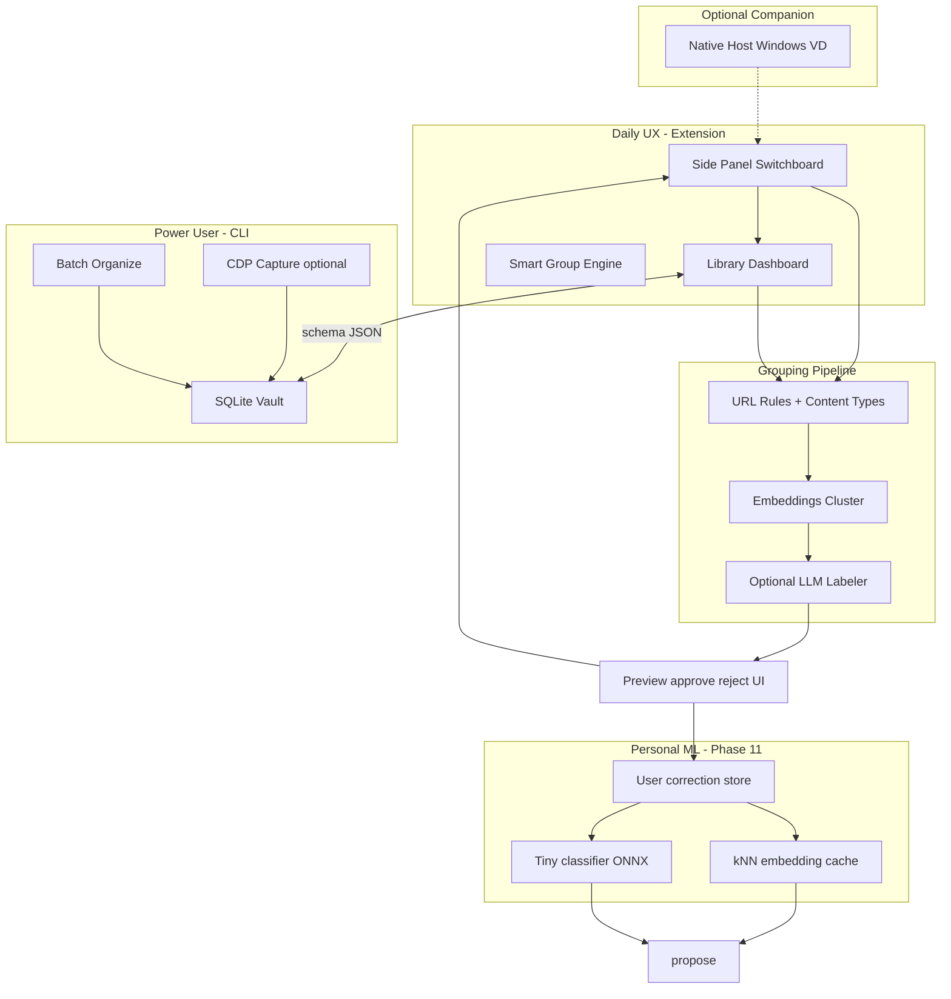

# Tab Discovery, Grouping & Architecture — Research Plan

## Executive verdict

**Your current approach is sound for the core problem** (9–10 Windows virtual desktops × many Brave windows). The **Chromium extension using `browser.windows.getAll({ populate: true })` is the right primary surface** — it is the only practical way to get rich, live tab state (window ID, active tab, groups, pinned, audible, discard) across all browser windows in a profile without launching Brave with `--remote-debugging-port`.

The **Python CLI + optional CDP** path is correctly positioned as a **power-user vault/automation companion**, not the daily driver. CDP `/json/list` is intentionally read-only and metadata-poor compared to extension APIs.

**Biggest gaps today:** Phase 7 AI is CLI-only; no virtual-desktop labels; grouping intelligence is hostname-only (deterministic) or a single monolithic LLM prompt (Mistral/Gemini). **Highest ROI next steps:** wire AI organize into the extension, add a layered grouping pipeline (heuristics → embeddings → optional LLM), and add Ollama/local-model support.

---

## Part 1 — How Tabman gets tabs today

### Primary path: Extension (live switchboard)

```79:87:extension/src/background-service.ts
async function getSnapshot(): Promise<SwitchboardResponse> {
  const windows = await browser.windows.getAll({
    populate: true,
    windowTypes: ['normal'],
  });
  return {
    ok: true,
    snapshot: buildSwitchboardSnapshot(windows),
  };
}
```

**What this gives you per tab** ([`extension/src/switchboard.ts`](extension/src/switchboard.ts)):

- `id`, `windowId`, `index`, `title`, `url`, `hostname`, `favIconUrl`
- `pinned`, `active`, `audible`, `discarded`, `groupId`
- Cross-window `duplicateCount` via normalized URL key

**What it does NOT give you:**

- Which **Windows virtual desktop** a window is on (no OS integration)
- Incognito tabs in park flows (blocked by design today — see **Incognito options** below)
- Popup/devtools windows (`windowTypes: ['normal']` only — see **Window types** below)
- Page content, OG metadata, visit history (not requested in MVP)

### Incognito options (user question)

Today [`background-service.ts`](extension/src/background-service.ts) blocks parking incognito tabs. This is a **product choice**, not a platform limitation.

**What Chrome/Brave actually allow** ([incognito manifest docs](https://developer.chrome.com/docs/extensions/reference/manifest/incognito)):

- Default manifest mode is `"spanning"`: one shared extension process sees **both normal and incognito** tabs; each tab/window has an `incognito: true` flag.
- User must manually enable **"Allow in incognito"** per extension in `chrome://extensions` — extensions are off in incognito by default for privacy.
- `"split"` mode = separate incognito process (needed if extension loads its own pages into incognito tabs; has caveats with content scripts).
- `"not_allowed"` = extension cannot run in incognito at all.

**Tabman could support incognito with a tiered privacy model:**

| Mode                  | Switchboard list    | Search/focus | Park to library                                                                     | AI organize             |
| --------------------- | ------------------- | ------------ | ----------------------------------------------------------------------------------- | ----------------------- |
| **Off (default)**     | Hidden              | Hidden       | Blocked                                                                             | Blocked                 |
| **Ephemeral only**    | Show in switchboard | Yes          | Blocked — never persist URLs                                                        | Blocked                 |
| **Park with warning** | Show                | Yes          | User confirms; stored in separate "Incognito" collection, never exported by default | Opt-in, title+host only |
| **Full (power user)** | Show                | Yes          | Same as normal collections                                                          | Same as normal          |

**Recommendation:** Ship **Ephemeral only** first — lets multi-desktop users find/focus incognito tabs without persisting sensitive URLs. Add explicit opt-in for park/AI later. Surface a one-time onboarding card: "Enable Allow in incognito if you use private windows."

### Window types — what is excluded? (user question)

[`chrome.windows.WindowType`](https://developer.chrome.com/docs/extensions/reference/api/windows#type-WindowType) values:

| Type           | What it is                               | Typical tabs inside | Include in switchboard?  |
| -------------- | ---------------------------------------- | ------------------- | ------------------------ |
| **`normal`**   | Standard browser window                  | User tabs           | **Yes (current)**        |
| **`popup`**    | Popup window (e.g. OAuth, small dialogs) | Sometimes 1 tab     | Optional — usually noise |
| **`devtools`** | Developer Tools window                   | Debugger UI         | No — not user tabs       |
| **`panel`**    | Deprecated Chrome App panel              | N/A                 | No                       |
| **`app`**      | Deprecated Chrome App window             | N/A                 | No                       |

Default API filter when `windowTypes` is unset: `['normal', 'popup']`. Tabman filters to **`normal` only** to avoid polluting the switchboard with OAuth popups and extension popups.

**Could expand later:** add `popup` behind a setting ("Show popup windows") for edge cases where users keep important tabs in popups — rare.

**Virtual desktop behavior (important nuance):**

- Chromium **does** expose all profile windows to extension APIs regardless of which Windows virtual desktop they sit on — this is why cross-window search/focus solves your daily pain without OS APIs.
- Chromium internally tracks virtual desktops for session restore and "open link on current desktop" behavior, but **does not expose desktop ID to extensions**.
- Windows offers `IVirtualDesktopManager::GetWindowDesktopId(HWND)` ([Microsoft docs](https://learn.microsoft.com/en-us/windows/win32/api/shobjidl_core/nf-shobjidl_core-ivirtualdesktopmanager-getwindowdesktopid)) — but an extension cannot call Win32. A native host _could_ map HWND → desktop GUID, but **this is deprioritized** (see Part 3B — extension-only alternatives preferred).



### Secondary path: CLI CDP capture

[`src/tabman/capture.py`](src/tabman/capture.py) hits `http://127.0.0.1:9222/json/list` (read-only HTTP, no WebSocket).

| Field               | Extension           | CDP `/json/list`         |
| ------------------- | ------------------- | ------------------------ |
| windowId            | yes                 | no                       |
| active/pinned/group | yes                 | no (pinned always false) |
| lastAccessedAt      | yes (API)           | always null              |
| duplicate detection | yes                 | no                       |
| requires debug port | no                  | yes (security risk)      |
| cross-profile       | per profile install | per debug port instance  |

**Verdict:** Keep CDP as optional CLI fallback; never make it primary UX.

### Tertiary path: JSON import/export bridge

Extension IndexedDB ↔ shared schema ↔ CLI SQLite vault. This is the correct long-term sync mechanism without native messaging.

---

## Part 2 — Is this a good approach? Competitive landscape

### What competitors do

| Product / pattern                                                    | Tab discovery                  | Grouping                                   | Virtual desktop                            |
| -------------------------------------------------------------------- | ------------------------------ | ------------------------------------------ | ------------------------------------------ |
| **Tabman (yours)**                                                   | Extension APIs + optional CDP  | Deterministic hostname; AI in CLI only     | Cross-window focus (no VD label)           |
| **Workona / Session Buddy**                                          | Extension                      | Manual workspaces / session save           | No VD integration                          |
| **GroupThink / Hayatab / Gruper**                                    | Extension                      | LLM (cloud or Ollama/WebLLM)               | No VD integration                          |
| **TabIt / Weft / Aftermark**                                         | Extension (+ content for Weft) | TF-IDF, Louvain, heuristics — **no cloud** | No VD integration                          |
| **SupaSidebar (Mac)**                                                | macOS automation APIs          | Observe only                               | Cross-browser, Mac-only                    |
| **Playwright/CDP automation**                                        | Debug port                     | N/A for daily profile                      | Full browser control, unsafe for daily use |
| **Native messaging bridges** (Codex, OpenCode, Browser Agent Bridge) | Extension + local host         | Agent-driven                               | Can add OS APIs via host                   |

**Conclusion:** Your dual-surface (extension daily + CLI vault) matches best-in-class tab managers. You are **ahead** on library/park/restore UX vs most grouping-only extensions. You are **behind** on in-browser AI organize (Phase 7 incomplete), non-AI smart clustering (TabIt/Aftermark-style), and **full Raindrop-like bookmark feature parity** (see Part 10).

---

## Part 2B — Raindrop.io & similar services — feature deep dive

> Sources: [Raindrop.io](https://raindrop.io/), [help.raindrop.io](https://help.raindrop.io/), [Stella AI docs](https://help.raindrop.io/stella), [Karakeep](https://github.com/karakeep-app/karakeep), [Linkwarden](https://github.com/linkwarden/linkwarden), [TabBrain](https://github.com/ndg8743/TabBrain), [SiftMarks](https://github.com/Lling0000/SiftMarks), [bookmrkd](https://github.com/minhaj14d/bookmrkd)

### Raindrop.io — complete feature inventory

Raindrop is a **saved bookmark library** (not live tab manager). Tabman's unique wedge is **live tabs → park → library**. Raindrop features to mimic for bookmark parity:

| Category          | Raindrop feature                            | Tabman today            | Mimic?  | Priority | Notes                                                      |
| ----------------- | ------------------------------------------- | ----------------------- | ------- | -------- | ---------------------------------------------------------- |
| **Save**          | Browser extension one-click save            | Park selection/window   | Partial | P0       | Park = save+close; add "Save without closing"              |
| **Save**          | Save with note on capture                   | No                      | Yes     | P1       | Note field on park/save                                    |
| **Save**          | AI suggested tags on save (✦)               | No                      | Yes     | P1       | Stella-style suggest, user picks                           |
| **Collections**   | Nested collections                          | Flat collections        | Yes     | P1       | Add parent `collectionId` to schema                        |
| **Collections**   | Custom icons/colors                         | Color on collection     | Partial | P2       | Icons from domain favicon stack                            |
| **Collections**   | Share collection (public link)              | No                      | Defer   | P3       | Conflicts with local-first; optional export                |
| **Collections**   | Team collaboration                          | No                      | Defer   | P3       | Out of MVP scope                                           |
| **Tags**          | Multi-tag per bookmark                      | Tags exist in schema    | Partial | P0       | Wire fully in save/edit flows                              |
| **Tags**          | Tags auto-created on first type             | No                      | **Yes** | P0       | Raindrop pattern — type new tag → create                   |
| **Tags**          | Rename tag globally                         | No                      | Yes     | P1       | Update all tabs referencing tag id                         |
| **Tags**          | Merge duplicate tags ("recipe"/"recipes")   | No                      | Yes     | P2       | Stella/AI or manual merge UI                               |
| **Tags**          | "Without tags" filter                       | No                      | Yes     | P1       | Library filter                                             |
| **Filters**       | Filter by tag, type, date                   | Basic in library        | Partial | P1       | Expand filter bar                                          |
| **Filters**       | Favorites filter                            | No                      | Yes     | P1       | `favorite: boolean` on Tab                                 |
| **Filters**       | Reminder filter                             | No                      | Yes     | P2       | `reminderAt` + `chrome.alarms`                             |
| **Filters**       | Has note / has highlights                   | No                      | Partial | P2       | Notes P1; highlights defer                                 |
| **Content type**  | Auto-detect article/video/image/doc         | No                      | Yes     | P1       | Tier 0 URL parser + OG type                                |
| **Search**        | Full-text title/desc/URL/tags               | Hostname suffix (CLI)   | Partial | P1       | FTS in IndexedDB + vault                                   |
| **Search**        | Semantic "meaning" search                   | No                      | Yes     | P2       | Local embeddings when vault grows                          |
| **Search**        | Search operators (`#tag`, `type:`, `-word`) | No                      | Yes     | P2       | [Raindrop filter syntax](https://help.raindrop.io/filters) |
| **Search**        | Search page content                         | Pro + archive required  | Defer   | P3       | Needs web archive — heavy                                  |
| **Views**         | Grid / List / Headlines / Masonry           | List/grid in library    | Partial | P2       | UI secondary per user                                      |
| **Duplicates**    | Duplicate detection                         | Cross-window live only  | Partial | P1       | Extend to library on save                                  |
| **Broken links**  | Broken link checker                         | No                      | Yes     | P2       | HEAD request batch job                                     |
| **Highlights**    | In-page text highlights                     | No                      | Defer   | P3       | Needs content script                                       |
| **Archive**       | Permanent web archive copy                  | No                      | Defer   | P3       | Linkwarden/Karakeep territory                              |
| **Reminders**     | Notifications on bookmarks                  | No                      | Yes     | P2       | `chrome.alarms` + optional note                            |
| **Import/Export** | Chrome/Pocket/Netscape/HTML                 | JSON + legacy           | Partial | P1       | Add Raindrop export import                                 |
| **Sync**          | Cross-device cloud sync                     | No                      | Defer   | P3       | Local-first by design                                      |
| **AI (Stella)**   | Chat with library                           | No                      | Partial | P2       | CLI organize only today                                    |
| **AI (Stella)**   | Summarize articles/YouTube                  | No                      | Partial | P2       | YouTube transcript = fetch                                 |
| **AI (Stella)**   | Organize with confirm                       | CLI preview only        | **Yes** | P0       | Phase 7 — Stella pattern                                   |
| **AI (Stella)**   | Merge tags, find dupes via chat             | No                      | Yes     | P2       |                                                            |
| **AI (Stella)**   | MCP integration                             | No                      | Yes     | P3       | Karakeep/SiftMarks pattern                                 |
| **Mobile**        | iOS/Android apps                            | No                      | Defer   | P3       | Extension + export suffices                                |
| **Live tabs**     | Manage open tabs across windows             | **Yes — core strength** | N/A     | —        | Raindrop doesn't do this                                   |

**Mimic score:** ~**45% feature parity today** on bookmark/library features. With P0+P1 items → ~**75%** of what users actually use Raindrop for (excluding cloud sync, team, full archive, highlights).

### Similar services — what to steal

| Service                                                                                  | URL         | Best features to adopt                                                                                 | Skip                        |
| ---------------------------------------------------------------------------------------- | ----------- | ------------------------------------------------------------------------------------------------------ | --------------------------- |
| **[Karakeep](https://github.com/karakeep-app/karakeep)**                                 | OSS ~26k ⭐ | AI tag+summarize (Ollama), rule engine (IFTTT auto-tag), Meilisearch FTS, highlights, agent CLI/skills | Self-host server complexity |
| **[Linkwarden](https://github.com/linkwarden/linkwarden)**                               | OSS ~13k ⭐ | 3 AI tagging modes (auto / predefined vocab / existing tags), screenshot+PDF archive, reader view      | Team/cloud hosting          |
| **[Tab Session Manager](https://github.com/sienori/Tab-Session-Manager)**                | ~2k ⭐      | Auto-save sessions, workspace switch, tab group preservation, Karakeep import path                     | Google Drive sync           |
| **[Tabitha Workspaces](https://github.com/loganpendragonmultiverse/tabitha-workspaces)** | WXT+Preact  | Workspaces + sessions + wikilinks — closest OSS cousin to Tabman architecture                          |                             |
| **[TabBrain](https://github.com/ndg8743/TabBrain)**                                      |             | AI window topic labels (confirm/edit), Ollama local, duplicate detection                               |                             |
| **[SiftMarks](https://github.com/Lling0000/SiftMarks)**                                  |             | **Review queue before apply**, embeddings+FTS, MCP, Chrome write-back                                  |                             |
| **[bookmrkd](https://github.com/minhaj14d/bookmrkd)**                                    |             | Approve-before-apply, **local learning store (SCA)**, folder health scores                             |                             |
| **[Aftermark](https://github.com/DavidCanHelp/Aftermark)**                               |             | 17 content types, 6 deterministic clustering strategies, zero AI cost                                  |                             |
| **[HamHome](https://github.com/bingoYB/ham_home)**                                       |             | AI categorize, semantic search, duplicate→bookmark                                                     |                             |
| **[mymind](https://mymind.com/)**                                                        | Closed      | "Save now, organize never" AI auto-tagging                                                             | Cloud-only                  |
| **[Pocket](https://getpocket.com/)**                                                     |             | Distraction-free reader                                                                                | No collections depth        |
| **[Pinboard](https://pinboard.in/)**                                                     |             | Tag-only minimalism, API                                                                               | No UI richness              |

**Key insight:** No OSS project combines **Raindrop library** + **live multi-window switchboard**. Tabman's winning combo = **Tabman switchboard** + **Karakeep/Linkwarden library patterns** + **SiftMarks/bookmrkd confirm-gated AI**.

### Raindrop-like bookmark flows Tabman should add (feature-first, UI later)

1. **Save bookmark** (without closing tab) — extension context menu + side panel button
2. **Tags auto-create** — typing a new tag name creates `Tag` entity on first use (Raindrop behavior)
3. **Multi-tag** — comma-separated input; one collection, many tags
4. **Favorite toggle** — star on any saved tab
5. **Filter bar** — by tag, content type, favorite, date, "without tags"
6. **Duplicate on save** — warn if URL already in library
7. **Import Raindrop export** — JSON/HTML interchange
8. **Organize preview** — Stella pattern: approve all / reject all / per-item accept/reject/edit tags manually

## Part 3 — With extension vs without extension

### Without extension (CLI-only / CDP-only)

**Possible:**

- Snapshot tabs via `--remote-debugging-port` (requires Brave restart with flag)
- Import/export vault JSON
- Batch AI organize on saved collections
- Scripting, Obsidian/git workflows

**Not possible (or very painful):**

- Live cross-window search and focus
- Native tab group create/rename/apply
- Park (close tabs into library) with one click
- Side panel UX
- Safe operation on daily profile (CDP port = unauthenticated local root access)
- Real-time duplicate detection across windows

**Who it's for:** Automation nerds, CI, headless capture, vault maintenance — **not** the 9-desktop daily workflow.

### With extension (current + recommended primary)

**Unlocks:**

- Full `chrome.tabs` / `chrome.tabGroups` / `chrome.windows` surface
- Side panel switchboard (already built)
- Park → IndexedDB library → restore loop (already built)
- Live events (tab created/updated/removed) with debounced refresh
- Future: apply AI groups directly to native tab groups
- Future: optional `chrome.history`, `chrome.bookmarks` for context enrichment (GroupThink pattern — opt-in)

**Extension-only extras worth adding:**

| Feature                              | API / technique                                                 | Effort               | Value             |
| ------------------------------------ | --------------------------------------------------------------- | -------------------- | ----------------- |
| Apply AI groups to native tab groups | `tabs.group` + `tabGroups.update`                               | Low (reuse existing) | High              |
| Visit frequency context              | `chrome.history` (permission on demand)                         | Medium               | Medium            |
| Session crash recovery               | `chrome.sessions` (already permitted)                           | Medium               | High              |
| Window naming / workspace tags       | `storage` + user labels                                         | Low                  | High for VD users |
| Snooze / alarms                      | `chrome.alarms`                                                 | Medium               | Medium            |
| Page metadata (OG)                   | Optional content script or `fetch` from SW with host permission | Medium–High          | High for grouping |

### Hybrid: Extension + Native Messaging + CLI

A **third architecture** worth planning for (not MVP):



**When native messaging pays off:**

- Label windows with Windows virtual desktop ID/name
- Run Ollama locally without CORS/host-permission friction
- Heavy embedding/clustering in Python (numpy, sklearn) on 200+ tabs
- Obsidian / file-system integrations
- Optional: move window to desktop (via `IVirtualDesktopManager::MoveWindowToDesktop`)

**Costs:** Windows install complexity, host manifest registry, 1 MB message limit, process lifecycle quirks on Windows ([Chrome 113+ native host changes](https://groups.google.com/a/chromium.org/g/chromium-extensions/c/6FZBwUx1OZc)).

**Recommendation:** Ship MVP without native messaging. Native host remains **Phase 9 optional / last resort** for true OS VD IDs. **Prefer Part 3B extension-only substitutes first.**

### Part 3B — Virtual desktop substitutes WITHOUT native messaging (user preference)

Since the extension was already an add-on, avoid Windows COM/native host complexity. **No OSS tab manager solves true OS virtual desktop mapping without native code** — but these extension-only patterns work well for 9–10 desktop workflows:

| Approach                                | Source / inspiration                                                                                                                 | How it works                                                               | Effort | Value                                                                                                  |
| --------------------------------------- | ------------------------------------------------------------------------------------------------------------------------------------ | -------------------------------------------------------------------------- | ------ | ------------------------------------------------------------------------------------------------------ |
| **User context labels**                 | Tabman plan, [Tablio](https://github.com/ZMelliti/tablio), [Tabitha](https://github.com/loganpendragonmultiverse/tabitha-workspaces) | Hotkey "Label window → Work/Research/Personal"; store in IndexedDB         | Low    | **High**                                                                                               |
| **Hostname-set fingerprint**            | [tab-groups-windows-list](https://github.com/thewoolleyman/tab-groups-windows-list) pattern                                          | Jaccard on open hostname sets reattaches label after browser restart       | Medium | High                                                                                                   |
| **AI topic detect + confirm**           | [TabBrain](https://github.com/ndg8743/TabBrain)                                                                                      | LLM proposes window name from titles; user edits/accepts                   | Medium | High                                                                                                   |
| **Park-with-context**                   | Tabman park flow                                                                                                                     | Context label saved into collection metadata at park time                  | Low    | Medium                                                                                                 |
| **Named sessions**                      | [Tab Session Manager](https://github.com/sienori/Tab-Session-Manager), [Stowtab](https://github.com/gilleswainrib-ext-boop/stowtab)  | "Desktop 3 snapshot" as named restorable session — not live OS state       | Medium | Medium                                                                                                 |
| **Context filter in switchboard**       | Tabman side panel                                                                                                                    | Filter tabs by user label, not OS desktop                                  | Low    | **High**                                                                                               |
| **Chrome tab groups as micro-desktops** | [SmartTab Organizer](https://github.com/EspritVorace/smart-tab-organizer)                                                            | Color groups within window = sub-context                                   | Low    | Medium                                                                                                 |
| **Chrome "Name window"**                | Built-in Brave/Chrome (no extension API)                                                                                             | User names window in browser UI; extension reads `window.title` if exposed | Zero   | Low — API limited ([crbug.com/1190160](https://bugs.chromium.org/p/chromium/issues/detail?id=1190160)) |

**Recommended MVP path for VD pain:**

1. User labels windows with context (keyboard shortcut)
2. Switchboard filter by context
3. Fingerprint reattach after restart
4. Optional AI topic suggestion ([TabBrain](https://github.com/ndg8743/TabBrain))
5. Park preserves context in collection name/tags

**Defer:** `IVirtualDesktopManager` native host unless users explicitly request true desktop ID badges.

---

## Part 4 — Grouping: AI, non-AI, and hybrid pipeline

Design principle (borrowed from [Aftermark](https://github.com/DavidCanHelp/Aftermark)): **deterministic code owns structure; LLM interprets meaning**.

### Tier 0 — Free, instant, offline (expand current deterministic)

Current [`DeterministicProvider`](src/tabman/organize.py): collection = hostname; tags = TLD labels.

**Upgrade to a rules engine (no ML):**

1. **URL parsing extractors** (zero network):
   - YouTube: `videoId`, channel from `/watch?v=`, `/@handle`, `/channel/UC...`
   - GitHub: `owner/repo`, issue/PR number, path type (`tree`, `pull`, `issues`)
   - Reddit: subreddit, post id
   - Docs: `readthedocs`, `/docs/`, `developer.*`
   - Shopping: `/product/`, `/dp/` (Amazon), cart patterns
   - Academic: `arxiv.org/abs/`, `doi.org`
   - Maps: `/place/`, coordinates
   - Generic: registrable domain, path segments, query keys (`q`, `search`)

2. **Content-type classifier** (regex + domain map — Aftermark's 17 types):
   `github-repo`, `article`, `video`, `docs`, `forum`, `shopping`, `social`, `tool`, `news`, `unknown`, etc.

3. **Clustering strategies** (pick best match):
   - Domain bucket (5+ tabs same registrable domain)
   - Path thread (`/issues/`, `/pull/` same repo)
   - GitHub project detection (same `owner/repo`)
   - Time session (tabs created within 30-min window — needs `lastAccessedTime` from extension)
   - Shopping/decision window (2-hour heuristic)
   - Subdomain affinity (`docs.stripe.com` + `dashboard.stripe.com`)

4. **Duplicate / near-duplicate merge** (already have URL key; add Jaccard on title tokens)

**Cost:** $0 · **Latency:** <50ms for 100 tabs · **Quality:** Good for 60–70% of tabs (heuristic baseline; user feedback loop improves this over time — see Part 11)

### Tier 0B — Hierarchical tagging (user question: YouTube as category vs sub-category)

Tags need **not be mutually exclusive or single-depth**. Raindrop allows overlapping tags; Tabman should too.

**Example — one YouTube tab could receive:**

| Level                | Tag examples                                 | How derived                   |
| -------------------- | -------------------------------------------- | ----------------------------- |
| Platform             | `youtube`, `video`                           | URL parser (deterministic)    |
| Channel              | `@Fireship`, `channel:UC...`                 | URL path                      |
| Topic (AI/heuristic) | `react`, `frontend`, `tutorial`              | Title tokens + embedding      |
| User intent (AI)     | `learning`, `entertainment`, `reference`     | LLM or user                   |
| Niche (AI/user)      | `marvel-cinematic-universe`, `documentaries` | LLM suggestion; user confirms |

**No right/wrong:** YouTube can be a **collection** ("Videos") OR a **tag** (`youtube`) OR both. User approval flow resolves ambiguity. System learns user preference over time (Part 11).

**Collection vs tag decision rule (default heuristic):**

- Same platform + different topics → one collection "Videos", topic tags differ
- Same project across sites → one collection named after project, domain as tags
- User override always wins and trains future defaults

### Tier 1 — Embeddings / graph clustering (local, no API)

Inspired by [TabIt](https://github.com/Yucklys/TabIt) (TF-IDF + Leiden), [Weft](https://github.com/Avi-141/weft) (Louvain + PageRank), [Grooopy](https://github.com/shubhams2m/grooopy) (local embeddings + agglomerative clustering):

**Pipeline:**

1. Build feature string per tab: `{contentType} {hostname} {pathKeywords} {title}`
2. Embed via:
   - **Extension:** [`@huggingface/transformers`](https://github.com/huggingface/transformers.js/) (Transformers.js) — WASM on CPU or WebGPU; see **Tiny model tiers** below
   - **CLI:** `sentence-transformers` or Ollama embeddings endpoint
3. Cosine similarity matrix + domain affinity boost
4. Cluster: Louvain / agglomerative hierarchical (Grooopy pattern)
5. Label clusters: TF-IDF top terms or template names ("Frontend · React", "AWS Billing")

**Tiny model tiers for average laptops** ([Transformers.js docs](https://huggingface.co/docs/transformers.js/en/index), [localmode.dev WebLLM guide](https://localmode.dev/docs/webllm)):

| Model                                   | Size   | Task                      | Runs on                  | Latency (100 tabs) |
| --------------------------------------- | ------ | ------------------------- | ------------------------ | ------------------ |
| **SmolLM2-135M-Instruct**               | ~78MB  | Label generation (WebLLM) | Any laptop + WebGPU/WASM | 2–10s              |
| **Qwen2-0.5B-Instruct**                 | ~300MB | Label generation          | Most laptops             | 5–15s              |
| **Llama-3.2-1B-Instruct** (q4)          | ~700MB | Label generation          | 8GB+ RAM laptops         | 10–30s             |
| **Xenova/all-MiniLM-L6-v2** (q8)        | ~23MB  | Embeddings only           | **Any laptop CPU**       | 1–3s               |
| **Xenova/e5-small**                     | ~30MB  | Embeddings                | Any laptop CPU           | 1–3s               |
| **Xenova/distilbert-base-uncased** (q4) | ~20MB  | Zero-shot classification  | Any laptop CPU           | <1s per tab batch  |

**Recommendation for "runs on most laptops":** Default to **MiniLM/e5-small embeddings + heuristic labels** (Tier 1). Offer **SmolLM2-135M or Qwen2-0.5B** as optional "name my groups" upgrade — not 7B models.

**Note on [Colibrì](https://github.com/JustVugg/colibri)** ([YouTube: "This Tiny Engine Runs Impossibly Big AI Models Locally!"](https://www.youtube.com/watch?v=3OqZHYNKc9A)): Colibrì is a disk-streaming inference engine for **744B MoE models** on consumer RAM — impressive for research, **wrong tool for tab grouping**. It needs ~370GB disk + ~25GB RAM and runs at 0.05–1 tok/s. Do **not** integrate Colibrì for Tabman. The relevant "tiny" path is **SmolLM2-135M / MiniLM / DistilBERT in-browser**, not Colibrì-scale engines.

**Cost:** $0 · **Latency:** 1–5s for 100 tabs · **Quality:** Strong semantic grouping without cloud

### Tier 2 — LLM batch organize (current + improvements)

Current prompt in [`organize.py`](src/tabman/organize.py) sends **all tabs in one JSON blob** — good batching instinct, but naive for 100+ tabs.

**Token efficiency tactics:**

| Technique                                                                                                                      | Savings                                                                                                                                                                  | Tradeoff                        |
| ------------------------------------------------------------------------------------------------------------------------------ | ------------------------------------------------------------------------------------------------------------------------------------------------------------------------ | ------------------------------- |
| Send **compressed tab records** (`id`, `t`, `h`, optional path tokens) not full URLs                                           | 30–50% input                                                                                                                                                             | Slightly less context           |
| **Pre-cluster with Tier 0/1**, LLM only names/refines clusters                                                                 | 70–90%                                                                                                                                                                   | Two-stage latency               |
| **One prompt per cluster** (10–20 tabs each) vs one giant prompt                                                               | Better accuracy ([batch size research](https://www.linkedin.com/posts/gregory-druck-8977b825_when-classifying-short-texts-using-llms-activity-7325519447639674880-h99O)) | More API calls but smaller each |
| **Cache grouping by hostname/path fingerprint**                                                                                | Near-zero on repeat                                                                                                                                                      | Stale if intent changes         |
| **Structured output** (JSON schema / Ollama `format`)                                                                          | Fewer repair tokens                                                                                                                                                      | Already partially done          |
| **Use flash/small models** for naming; large model only for ambiguous clusters                                                 | 80%+ cost cut                                                                                                                                                            | Slightly worse names            |
| **Embeddings for assignment, LLM for labels only** ([arxiv embedding vs prompting](https://doi.org/10.48550/arxiv.2504.04277)) | 10–80× cheaper at scale                                                                                                                                                  | More engineering                |

**Recommended default flow for 64+ tabs:**



### Tier 3 — Context enrichment (opt-in, privacy-sensitive)

GroupThink-style optional signals:

- `chrome.history`: visit count, last visit → "Research rabbit hole" vs "daily driver"
- `chrome.bookmarks`: already saved → lower organize priority
- `chrome.sessions`: recently closed related tabs
- **Never** send page HTML to cloud by default

---

## Part 5 — Metadata parsing deep dive

### What you can get without fetching pages

| Source         | Data                   | Example                                    |
| -------------- | ---------------------- | ------------------------------------------ |
| URL alone      | Platform, IDs, paths   | `youtube.com/watch?v=abc` → Video          |
| Title          | Topic hints            | "Fix React useEffect bug - Stack Overflow" |
| Favicon        | Domain confirmation    | Already captured                           |
| Hostname rules | Content type           | `github.com` → code                        |
| Tab API        | Pinned, group, audible | Meeting tab detection                      |

### What requires lightweight fetch (extension SW or CLI)

**Link unfurling pattern** ([Slack-style OG parsing](https://malukenho.github.io/post/2026/06/15/system-design-web-link-unfurling.html)):

1. Platform-specific handler first (YouTube thumbnail URL from video ID — **no HTML fetch**)
2. Fallback: `fetch(url, { headers: { 'User-Agent': 'facebookexternalhit/1.1' } })` → parse `<meta property="og:*">`
3. Cache in IndexedDB with TTL (24h–7d)

**High-value parsers to implement first:**

- **YouTube:** video ID → title via oEmbed or noembed.com; channel from URL
- **GitHub:** repo API public endpoint (rate-limited but rich: language, topics, description)
- **ArXiv:** title from `/abs/` page or API
- **Reddit:** JSON append `.json` to post URL
- **Generic:** og:title, og:description, og:type

**Security:** SSRF protection — only http(s), block private IPs, size limits, timeout 3s.

**Where to run:**

- **Extension:** optional `host_permissions` per domain or proxy through CLI native host
- **CLI:** safer for bulk unfurl (no CORS)

---

## Part 6 — Local model options (no Claude/cloud)

Phase 7 in [`TABMAN-REBUILD-TASKS.md`](docs/TABMAN-REBUILD-TASKS.md) already lists Ollama — not yet implemented in [`organize.py`](src/tabman/organize.py) (only `deterministic`, `mistral`, `gemini`).

### Option A — Ollama (recommended first local path)

- **CLI:** POST `http://localhost:11434/api/chat` with `format: <JSON schema>` ([Ollama structured outputs](https://docs.ollama.com/capabilities/structured-outputs))
- **Extension:** runtime host permission for `http://localhost:11434/*` OR native messaging to CLI
- **Models:** `qwen2.5:3b`, `llama3.2:3b`, `mistral:7b`, `gemma2:2b` — sufficient for tab naming
- **Pros:** Easy setup, structured JSON, same API as Mistral provider (already has local HTTP support)
- **Cons:** User must install Ollama; GPU helps

### Option B — WebLLM in extension ([mlc-ai/web-llm](https://github.com/mlc-ai/web-llm))

- Runs in service worker via WebGPU ([Gruper pattern](https://github.com/amir20/gruper))
- **Pros:** No server, fully private, works offline after model download
- **Cons for large models:** ~1–5GB download, WebGPU required, MV3 service worker kill risk, slow on CPU-only machines
- **Extremely small models (user question):** Use **SmolLM2-135M** (~78MB) or **Qwen2-0.5B** (~300MB) via WebLLM — viable on most 2020+ laptops with WebGPU; fallback to Transformers.js WASM on CPU ([WebLLM model list](https://mlc.ai/models), [localmode.dev tiny models <500MB](https://localmode.dev/docs/webllm))
- **For tab grouping specifically:** WebLLM tiny models are sufficient for **naming 5–10 clusters** (short JSON output), not for classifying 200 tabs individually — pair with Tier 0/1 pre-clustering

### Option C — `@xenova/transformers` embeddings only (not generative)

- Use for Tier 1 clustering; deterministic label templates
- **Pros:** Small model, fast, no API
- **Cons:** Group names less natural than LLM

### Option D — llama.cpp / LM Studio / custom OpenAI-compatible

- Extend existing `MistralProvider` pattern: configurable `base_url` + model name
- Works for: LM Studio, llama.cpp server, vLLM, LocalAI

### Option E — Hybrid "AI lite"

- Embeddings cluster locally (Tier 1)
- User picks from 3 LLM-generated **collection name candidates** per cluster using tiny model
- Minimum tokens: ~50 output tokens per cluster

**Recommended provider registry (Phase 7 completion):**

| Provider          | Where runs | Privacy         | Cost          |
| ----------------- | ---------- | --------------- | ------------- |
| `deterministic`   | Both       | Full            | $0            |
| `heuristic-v2`    | Both       | Full            | $0            |
| `embeddings`      | Ext or CLI | Full            | $0            |
| `ollama`          | Localhost  | Full            | $0            |
| `webllm`          | Extension  | Full            | $0            |
| `gemini-flash`    | Cloud BYOK | Title+host sent | ~$0.001/batch |
| `mistral-small`   | Cloud BYOK | Title+host sent | ~$0.002/batch |
| `anthropic-haiku` | Cloud BYOK | Title+host sent | ~$0.003/batch |
| `openai-mini`     | Cloud BYOK | Title+host sent | ~$0.002/batch |

---

## Part 10 — User approval UX & tag auto-create (Raindrop + user requirements)

Mirrors Raindrop [Stella organize flow](https://help.raindrop.io/stella) and OSS patterns from [SiftMarks](https://github.com/Lling0000/SiftMarks), [bookmrkd](https://github.com/minhaj14d/bookmrkd), [organvm/tab-bookmark-manager](https://github.com/organvm/tab-bookmark-manager):

### Organize / classify preview screen

After AI or heuristic pipeline proposes groupings:

```
┌─────────────────────────────────────────────────────┐
│  Smart Organize — 47 tabs · 6 proposed collections │
│  [Approve All] [Reject All] [Apply Selected (12)]  │
├─────────────────────────────────────────────────────┤
│ ▼ Collection: "Frontend · React" (8 tabs)  [✓][✗]  │
│   ├─ react.dev/docs        tags: react, docs   [✓][✗][edit] │
│   ├─ youtube.com/watch…  tags: video, tutorial [✓][✗][edit] │
│   └─ ...                                            │
│ ▼ Collection: "Videos" (5 tabs)            [✓][✗]  │
│   └─ ...                                            │
└─────────────────────────────────────────────────────┘
```

**Per-item actions:**

- **Approve (✓)** — accept proposed collection + tags
- **Reject (✗)** — leave tab unchanged / move to "Unsorted"
- **Edit** — manually change collection name, add/remove tags, create new tags inline
- **Approve All** — bulk accept (with confirmation dialog)
- **Reject All** — discard entire proposal

**Tag auto-create (Raindrop behavior):**

- Tags are entities in schema (`Tag` with UUID) — already exist
- On edit: typing `marvel-cinematic-universe` when tag doesn't exist → **create tag on first use**, attach to tab
- Tag rename/merge propagates to all tabs (future P1)
- Comma-separated input in save/edit flows

**Nothing applies without explicit user action** — matches Stella: "any big changes need your confirmation first."

---

## Part 11 — Custom tiny model + human feedback loop (user question)

> "Can we train a very very very tiny model of our own? Scrape hundreds of links, AI tags them, user says if appropriate or not."

**Yes — but the practical path is NOT training a generative LLM from scratch.** Instead: **teacher labeling → user corrections → tiny classifier that learns YOUR taxonomy.**

### Why hierarchical tags have no single "right answer"

User is correct: YouTube as platform tag vs `videos` collection vs `documentaries` sub-tag are all valid. System should:

1. Propose with confidence score
2. Let user accept/reject/edit
3. Store correction as training signal
4. Prefer user's past choices for similar URLs/titles

### Three-tier model strategy (cheapest → most personal)



| Tier                        | What                                                                                                                                                                                                       | Size                    | When                            |
| --------------------------- | ---------------------------------------------------------------------------------------------------------------------------------------------------------------------------------------------------------- | ----------------------- | ------------------------------- |
| **A — Zero-shot / teacher** | Cloud or Ollama labels 500 seed URLs; user validates                                                                                                                                                       | N/A                     | Bootstrap                       |
| **B — Embedding + kNN**     | MiniLM embeddings stored in IndexedDB; nearest-neighbor of past approved tabs                                                                                                                              | ~23MB model             | After ~50 user corrections      |
| **C — Tiny classifier**     | DistilBERT/MobileBERT fine-tuned on user's approved labels                                                                                                                                                 | 20–70MB ONNX in browser | After ~200–500 labeled examples |
| **D — Active learning**     | Query most uncertain tabs first ([small-text](https://github.com/webis-de/small-text) + [active learning pattern](https://rubrix.readthedocs.io/en/stable/tutorials/active_learning_with_small_text.html)) |                         | Ongoing                         |

### Bootstrap dataset (your "scrape hundreds of links" idea)

**Phase A — Seed corpus (one-time, optional CLI command `tabman seed-label`):**

1. Collect ~500–2000 diverse URLs (user's open tabs + public curated lists: HN, Reddit, common docs sites)
2. Run **teacher** (Gemini Flash / Ollama) with structured output: `{contentType, platform, topicTags[], suggestedCollection}`
3. Store as `SeedLabel` records — **not applied to user library**
4. User reviews in batch UI: approve/reject/edit
5. Export as training JSONL in vault

**Phase B — Personal model (no server training required for MVP):**

- **Browser path:** Transformers.js `text-classification` pipeline fine-tuned via lightweight approach:
  - Store approved examples as `{text: "title + hostname + parsedUrlFeatures", labels: [...]}`
  - Use **kNN on embeddings** first (no training loop) — [Bookmark Lens](https://github.com/cornelcroi/bookmark-lens) pattern
  - Graduate to **SetFit-style few-shot** ([small-text + SetFit](https://github.com/argilla-io/argilla)) when 100+ examples per top label
- **CLI path ( richer ):**
  - Export corrections to JSONL
  - Fine-tune `distilbert-base-uncased` (66M params) with Hugging Face — runs inference in ONNX via Transformers.js
  - Knowledge distillation from teacher LLM ([PGKD pattern](https://arxiv.org/html/2411.05045v1)): teacher generates labels, student learns, user corrections refine

**Phase C — Reinforcement from user feedback (lightweight):**

- Not full RL — store `{tabFingerprint, proposedLabels, userLabels, action: accept|reject|edit}`
- On next similar tab (embedding cosine > 0.85): **bias proposal toward past userLabels**
- [bookmrkd SCA store](https://github.com/minhaj14d/bookmrkd) and [AI Tab Manager "learns preferences"](https://github.com/aitkn/ai-tab-manager) patterns

### Realistic expectations

| Approach                 | Min user labels | Quality                     | Runs in browser         |
| ------------------------ | --------------- | --------------------------- | ----------------------- |
| Heuristics only          | 0               | 60–70%                      | Yes                     |
| kNN on embeddings        | 30–50           | 75–85% personal             | Yes (~23MB)             |
| Fine-tuned DistilBERT    | 200–500         | 85–92% personal             | Yes (~70MB ONNX)        |
| Full generative tiny LLM | Not recommended | Overkill for classification | SmolLM2 for naming only |

**Do NOT train a generative model from scratch for tagging** — classification + cluster naming is the correct framing.

### YouTube sub-category example (end-to-end)

1. URL parse → `{platform: youtube, videoId, channel: "@Fireship"}`
2. Title → `"100s vs 1000s of hours of coding"`
3. Teacher/heuristic proposes: collection=`Learning`, tags=`[youtube, programming, fireship]`
4. User edits → collection=`Videos`, tags=`[youtube, coding-tips, fireship]`, sub-tag=`entertainment`
5. Store correction; next Fireship tab auto-suggests user's preferred pattern
6. Optional fetch: YouTube oEmbed for description → richer embedding

---

## Part 12 — Wild / open-minded ideas

**Near-term practical:**

- **Specificity slider** (GroupThink 1–10): controls cluster granularity in Tier 1
- **"Desktop context" user labels:** let user tag each window with "Work / Research / Personal" — proxy for virtual desktop intent without OS APIs
- **Stale tab scoring:** `lastAccessedTime` + `discarded` + duplicate → "Park stale (47 tabs)" one-click
- **Meeting mode:** detect `audible` + calendar-like titles → group "Active calls"
- **Reading queue:** long-form article detectors → single "Read later" collection

**Medium-term:**

- **Extension-only VD substitutes (Phase 9B):** context labels, fingerprint, AI topic — preferred over native host
- **Native messaging host `tabman-host.exe` (last resort):** VD labels, Ollama proxy, bulk unfurl, file export to Obsidian
- **Chrome 150+ CDP tab metadata** (`Target.getTargets` with `embedderData.tabActive/tabGroupId`) — only relevant if you deepen CLI CDP; extension APIs remain superior
- **Voice command:** "focus my Stripe tabs" via side panel search (no AI needed)

**Ambitious / experimental:**

- **On-device personal classifier** (Part 11) on user's park/restore + correction history — kNN → DistilBERT, not generative fine-tune
- **Graph view** (GroupThink treemap) of tab clusters in dashboard
- **Cross-browser** via separate Windows app (SupaSidebar-like) reading all browsers — huge scope, different product
- **MCP server:** expose tab vault + live snapshot to Cursor/Claude Desktop for agentic tab management
- **Automatic workspace ↔ virtual desktop sync:** when user switches Windows VD, suggest focusing matching window set (requires native host + undocumented VD APIs for enumeration)
- **Tab "DNA" fingerprint:** hash of (domain + path pattern + og:type) for persistent grouping memory across sessions
- **Collaborative local sync** via Syncthing/file share of vault JSON (no cloud server)

---

## Part 8 — Recommended forward roadmap

### Phase 7A — Complete AI in extension (highest user value)

Files: [`extension/src/`](extension/src/), mirror [`src/tabman/organize.py`](src/tabman/organize.py) logic in TS

- Provider registry: deterministic, Ollama, Gemini, Mistral, OpenAI-compatible custom URL
- Batch organize with Zod validation + **preview diff UI with approve all / reject all / per-item** (Stella + SiftMarks pattern)
- Apply to **native tab groups** + optionally save as **collection**
- Session-only API keys in `chrome.storage.session`
- **Tags auto-create on first type** in edit flows

### Phase 7B — Non-AI smart grouping (cost $0, big quality jump)

- Port URL parsers + content-type classifier (shared TS/Python in `packages/schema` or `packages/rules/`)
- TF-IDF or MiniLM clustering in extension for "Smart Group" button
- LLM becomes optional refinement layer
- **Hierarchical tags** — platform / topic / user-intent levels

### Phase 7C — Local model parity

- Add `OllamaProvider` to Python ([Ollama structured output API](https://docs.ollama.com/capabilities/structured-outputs))
- Extension Ollama client with runtime localhost permission
- Document `.env.example` with `OLLAMA_HOST`, `OLLAMA_MODEL`
- Add **SmolLM2-135M / MiniLM** browser paths via Transformers.js + optional WebLLM

### Phase 8 — Metadata enrichment (opt-in)

- Platform parsers (YouTube, GitHub, Reddit) without full page scrape where possible
- OG unfurl cache in IndexedDB
- Feed enriched `{type, platform, entity, title, hostname}` into grouping pipeline

### Phase 9B — Virtual desktop substitutes (preferred over native host)

- User context labels + keyboard shortcut ([TabBrain](https://github.com/ndg8743/TabBrain) / [Tabitha](https://github.com/loganpendragonmultiverse/tabitha-workspaces))
- Hostname-set fingerprint for label reattachment after restart
- AI topic detect with confirm for window naming
- Switchboard filter by context; park saves context in collection metadata
- Optional: named session snapshots ([Tab Session Manager](https://github.com/sienori/Tab-Session-Manager))

### Phase 9 (optional / last resort) — Native companion for Windows VD

- Small `tabman-host` native messaging binary — **only if Phase 9B insufficient**
- Map Brave window HWND → `IVirtualDesktopManager` desktop GUID
- Display "Desktop 3" badge in switchboard; optional "move window to current desktop"
- Offload heavy clustering/unfurl to Python

### Phase 10 — Raindrop-like bookmark feature parity

- Save bookmark without closing tab (context menu + side panel)
- Favorites, notes on save, duplicate-on-save warning
- Nested collections (schema migration)
- Filter bar: tag, type, favorite, date, without-tags
- Import Raindrop export; broken link checker (batch HEAD)
- Reminders via `chrome.alarms` (P2)

### Phase 11 — Personal micro-classifier

- Teacher bootstrap: `tabman seed-label` on 500+ URLs
- User correction store in vault (`CorrectionRecord` schema)
- kNN embedding cache in extension (MiniLM, ~23MB)
- Optional DistilBERT ONNX fine-tune via CLI when 200+ labels accumulated
- Active learning: surface uncertain tabs first ([small-text](https://github.com/webis-de/small-text))

### What NOT to do

- Do **not** make CDP the primary discovery path for daily users
- Do **not** send full URLs to cloud by default (path leaks tokens/session ids)
- Do **not** scrape page content in MVP without explicit opt-in
- Do **not** rely on single giant LLM prompt for 100+ tabs (accuracy drops with batch size)

---

## Part 13 — Architecture target state



---

## Summary answers to your questions

| Question                      | Answer                                                                                                                                   |
| ----------------------------- | ---------------------------------------------------------------------------------------------------------------------------------------- |
| Is our approach good?         | **Yes** — extension-first is industry best practice for live multi-window tab management                                                 |
| Can we improve?               | **Yes** — layered grouping, extension AI, Ollama, metadata parsers, Raindrop bookmark parity, personal micro-classifier                  |
| Extension vs without?         | **Extension required** for daily multi-desktop workflow; CLI alone is vault/automation only                                              |
| How much does extension help? | **Essential** for discovery, focus, park, native groups; ~90% of product value                                                           |
| Raindrop features mimicable?  | **~75%** of practical Raindrop library features (excluding cloud sync, team, full archive); **100%** of live-tab features Raindrop lacks |
| Incognito support?            | **Possible** — spanning mode + user enables "Allow in incognito"; recommend ephemeral list/focus first, park opt-in                      |
| Other window types?           | **`popup`**, **`devtools`**, deprecated **`panel`/`app`** — we filter to `normal` only                                                   |
| VD without native host?       | **Yes** — user context labels, fingerprint reattach, AI topic detect, park-with-context (Phase 9B preferred)                             |
| Local model path?             | **MiniLM embeddings first** (any laptop), SmolLM2-135M for naming, Ollama optional, Colibrì **not applicable**                           |
| Custom tiny model?            | **Yes** — teacher bootstrap + user corrections → kNN then DistilBERT ONNX; not generative training                                       |
| User approval UX?             | **Approve all / reject all / per-item / manual tag edit / auto-create tags** — Raindrop+Stella pattern                                   |
| Token efficiency?             | Pre-cluster → small LLM for labels only; compress payloads; flash models; cache                                                          |
| Non-AI grouping?              | URL parsers, content types, TF-IDF/Louvain, time sessions, domain buckets, hierarchical tags                                             |
| Metadata parsing?             | Platform-specific URL rules + optional OG unfurl with cache                                                                              |
| YouTube sub-categories?       | **Multi-level tags** — platform + topic + user niche; no single right answer; user feedback trains defaults                              |
