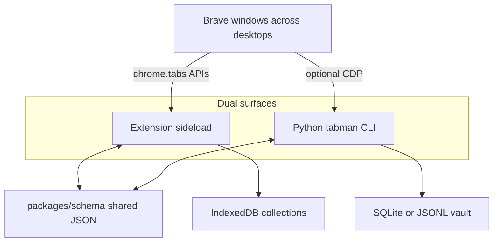

# Tabman Rebuild Plan

> **Date:** 2026-07-18 | **Branch:** `feat/rebuild` (from `main` HEAD) | **Repo:** [`Anshulgada/brave-tab-manager`](https://github.com/Anshulgada/brave-tab-manager) at `D:\brave-tab-manager`
>
> **Status:** Planning complete — ready for implementation. Clone on disk is done. Next: create `feat/rebuild`, scaffold monorepo tooling, then dual-surface MVP.
>
> **Version:** Single-source from root `pyproject.toml` (Python) and `extension/package.json` (extension). Never hardcode versions in CI, manifests, or artifact names.
>
> **Quick nav:** §2 decisions · §3 product · §4 layout · §5 extension · §6 CLI · §7 AI · §8 tooling · §9 distribution · §10 success · §11 agent prompt
>
> **Tasks:** [`TABMAN-REBUILD-TASKS.md`](TABMAN-REBUILD-TASKS.md) · **Research (deep dive):** [`TABMAN-REBUILD-RESEARCH.md`](TABMAN-REBUILD-RESEARCH.md)

---

## 1. Overview & Goals

Rebuild the grad-student Python CDP archiver into a **professional dual-surface product**:

| Surface                                   | Role                                                                      |
| ----------------------------------------- | ------------------------------------------------------------------------- |
| **Chromium extension** (primary daily UX) | Live multi-window **switchboard** + Raindrop-like **collections library** |
| **Python CLI `tabman`** (power users)     | Local vault, batch AI organize, import/export, scripting                  |
| **Shared schema**                         | Versioned JSON so extension ↔ CLI round-trip                              |

**Inspiration:** [Raindrop.io](https://raindrop.io/) (collections, tags, views, Stella-style suggest→confirm). **Gap:** Raindrop manages _saved_ bookmarks; this product manages _open_ tabs across many Brave windows / Windows virtual desktops.

**Job to be done:** "Show everything open across windows, find/park/group/restore instantly, keep a beautiful local library — no cloud fees, no Web Store fee required."



---

## 2. Resolved Decisions

| Topic                       | Decision                                                                                                                                       |
| --------------------------- | ---------------------------------------------------------------------------------------------------------------------------------------------- |
| **Branch**                  | `feat/rebuild` from `main` HEAD at `D:\brave-tab-manager`                                                                                      |
| **Layout**                  | **Complete overhaul allowed** — `src/tabman/`, `extension/`, `packages/schema/`; do not preserve old flat `tabman/` for nostalgia              |
| **Extension framework**     | **WXT + React + TypeScript** — not Next.js (SSR/`chrome-extension://` mismatch); not Plasmo/CRXJS as default                                   |
| **UI metaphor**             | Raindrop-like **collections** + live **window switchboard**; not a cloud Raindrop clone                                                        |
| **Primary install**         | **Sideload / Load unpacked** + CI ZIP; Web Store optional later (no fee gate)                                                                  |
| **Python tooling**          | **uv** + `pyproject.toml` + `uv.lock`; Ruff, ty, Bandit, detect-secrets, pip-audit (SokWatch-style)                                            |
| **Extension tooling**       | **Bun** + Node 24 LTS + Biome + `tsc --noEmit` (SokWatch docs-stack style)                                                                     |
| **Hooks**                   | One `.pre-commit-config.yaml` covering Python + extension; pre-push path-filtered build/test gates                                             |
| **AI**                      | Optional BYOK; **batch** tabs in one request; **Pydantic/PydanticAI** (CLI) + **Zod** (extension); validate in code; preview → confirm → apply |
| **AI payload default**      | Title + hostname only; full URL opt-in; no page scrape in MVP                                                                                  |
| **Persistence (extension)** | Dexie / IndexedDB                                                                                                                              |
| **Persistence (CLI)**       | SQLite or JSONL source of truth; Markdown export-only                                                                                          |
| **Capture (CLI)**           | CDP optional; prefer import from extension export                                                                                              |
| **PyQt GUI**                | Optional extra or drop until quality-matched — no undeclared deps                                                                              |
| **Out of MVP**              | Cloud sync, full-text archive, highlights, team sharing, paid store listing                                                                    |

---

## 3. Product Vision (MVP)

### Be

- Local-first window switchboard + session/collection library (Workona spaces × Raindrop collections × OneTab park).
- Instant search across **all** open windows (critical for 9–10 virtual desktops).
- Park window/selection → named collection → restore later.
- Optional Smart Organize with Stella-style confirmation.

### Do not be (MVP)

- Cloud bookmark manager competing with Raindrop.
- CDP-only Markdown dump as the primary daily UX.

### Core flows

1. Side panel → all windows + tab counts → search → focus tab/window.
2. Park window or selection → collection in library.
3. Library: collections, tags, list/grid, filters, bulk actions, trash.
4. Smart Organize (optional): one batched AI proposal → preview → confirm → apply.
5. CLI: vault/automation with shared schema.

---

## 4. Target Monorepo Layout

```
brave-tab-manager/
  pyproject.toml
  uv.lock
  .pre-commit-config.yaml
  .secrets.baseline
  src/tabman/
  tests/
  extension/
    package.json
    bun.lock
    wxt.config.ts
    entrypoints/
    biome.json
    tests/
  packages/schema/
  docs/
    TABMAN-REBUILD-PLAN.md
    TABMAN-REBUILD-TASKS.md
    TABMAN-REBUILD-RESEARCH.md
  .github/workflows/ci.yml
```

---

## 5. Extension (WXT + React)

### Surfaces

- `background` — tabs APIs, messaging, AI fetch
- `sidepanel` — daily switchboard
- `dashboard` — Raindrop-like library + settings + onboarding

### Permissions

- Required: `tabs`, `tabGroups`, `storage`, `sessions`, `sidePanel`
- Optional host permissions at runtime for AI endpoints
- No content scripts / page scraping in MVP

### UX must-haves

- Cross-window search and activate
- Park / restore collections
- Duplicates across windows
- List/grid library, tags, bulk actions
- System light/dark, a11y, confirm destructive bulk ops

### Distribution

- Document Brave/Chrome **Load unpacked**
- CI uploads sideload ZIP via `wxt zip`
- Web Store publish is optional backlog

---

## 6. Python CLI (`tabman`)

### Toolchain

- `requires-python >=3.12`, uv, SokWatch-like `[tool.ruff]` / `[tool.ty]` / `[tool.bandit]` / pytest in `pyproject.toml`

### Subcommands (Typer or rich-click)

`capture`, `organize`/`categorize`, `search`, `export`, `import`, `config`, `version`

### Correctness (fix during rewrite)

- Search prints JSON/results (no bogus `await`)
- Mistral `base_url`; dedicated YouTube key if kept
- Proper domain suffix matching
- No Gemini configure-at-import before keys
- Align `--version` with `pyproject.toml`
- Secrets via env/config-dir/prompt — not argv
- Safe CDP disconnect (no casual `browser.close()` on daily profile)

### AI

- Same batch + Pydantic structured output as extension; review/`--apply` flag

---

## 7. Shared Schema & AI Contract

- `packages/schema/` defines collection/session/tab/tag/proposal documents
- Extension: Zod parse in service worker before UI preview
- CLI: Pydantic / PydanticAI validate before write
- Batch: one response maps all input tabs → suggested collection + tags
- Deterministic local domain/title grouping always available offline

---

## 8. Tooling & CI (SokWatch-aligned)

| Stack     | Tools                                                                         |
| --------- | ----------------------------------------------------------------------------- |
| Python    | uv, Ruff, ty, Bandit, detect-secrets, pip-audit                               |
| Extension | Bun, Biome, tsc, Vitest, wxt build/zip                                        |
| Hooks     | pre-commit (fast) + pre-push (path-filtered gates)                            |
| CI        | `python` job + `extension` job; sideload ZIP artifact; publish gated/optional |

Also: `.gitattributes`, `CHANGELOG.md`, `.env.example`, hardened `.gitignore`, `CONTRIBUTING.md`, `SECURITY.md`, `CODE_OF_CONDUCT.md`, `docs/dos-and-donts.md`, Cursor rules.

---

## 9. Distribution & Privacy

- Local-only default; AI opt-in BYOK
- Document: browser storage ≠ OS keychain; session-only keys + forget-key
- No Web Store fee required to use the product
- PyPI publish optional after CLI is green

---

## 10. Success Criteria (MVP)

- [ ] Work on `feat/rebuild`; versions single-sourced
- [ ] Monorepo layout live (`src/tabman`, `extension`, `packages/schema`)
- [ ] Extension sideloads in Brave; switchboard searches/focuses across windows
- [ ] Park ↔ restore collections works with clear failure feedback
- [ ] Library has collections, tags, list/grid, bulk actions
- [ ] Optional AI: batch structured proposal → confirm → apply (or deterministic fallback)
- [ ] CLI: subcommands, vault persistence, shared-schema import/export
- [ ] pre-commit + CI green for unit tests (no live keys required)
- [ ] README documents Load unpacked + CLI; PRIVACY.md present
- [ ] Legacy Prompt.md / .structure / BrowserStack claims archived or removed in cleanup phase

### Explicitly deferred

- Cloud sync, Stella-class full-text archive, store listing, Firefox, OS virtual-desktop APIs

---

## 11. AI Agent Prompt Template

Copy this into a new agent when continuing implementation:

```markdown
You are working on the brave-tab-manager project at `D:\brave-tab-manager`.

Read `docs/TABMAN-REBUILD-PLAN.md` — canonical rebuild plan.
Then read `docs/TABMAN-REBUILD-TASKS.md` — phase-by-phase checklist.
Optional deep dive: `docs/TABMAN-REBUILD-RESEARCH.md` (iteration notes — not the execution source of truth).

Execute **Phase [X]** from the task checklist.

### Branch

- All work on `feat/rebuild` until reviewed merge to `main`.
- Create from main if needed: `git fetch origin && git checkout -b feat/rebuild origin/main`
- Do not push or publish unless the user explicitly asks.

### Product facts

- Dual surface: sideload Chromium extension (daily UX) + Python CLI vault (automation).
- Metaphor: Raindrop-like local collections + live multi-window switchboard — NOT a cloud Raindrop clone.
- Extension stack: WXT + React + TypeScript + Bun + Biome (NOT Next.js as the extension shell).
- Python stack: uv + src/tabman + Ruff + ty + SokWatch-style pre-commit.
- AI: optional BYOK; batch tabs; Pydantic/Zod schema enforcement; preview → confirm → apply.
- Distribution: Load unpacked / CI ZIP primary; Web Store optional.

### Coding standards

- Complete layout overhaul is allowed (`src/`, `extension/`, `packages/schema/`).
- Least-privilege permissions; no page-content scraping in MVP.
- Never put API keys on CLI argv or in logs.
- Single-source versions; never hardcode in CI/artifacts.
- Do not run `git commit` or `git push` unless the user explicitly asks.
- Before preparing or making commits, read and follow `.cursor/skills/tabman-commits/SKILL.md`; use its atomic grouping, version, lockfile, check, and message rules.
- Update `TABMAN-REBUILD-TASKS.md` checkboxes in the last commit of a batch when committing is requested.

Start Phase [X]. Report progress when the phase gate is met.
```
