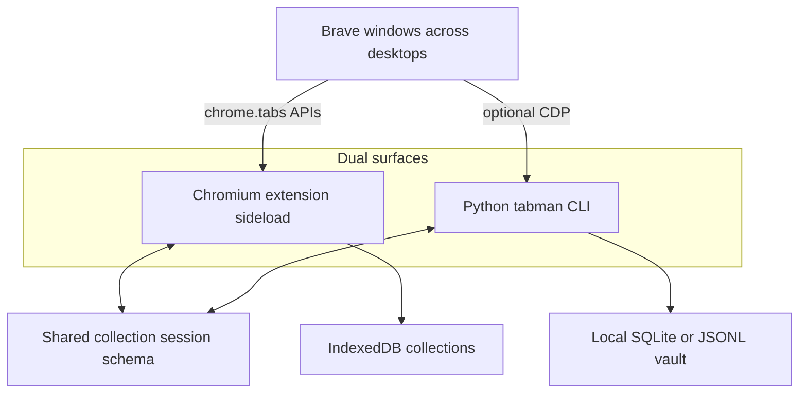

# Tabman Rebuild — Research

> **Research archive** — full planning iteration notes (July 2026). **Do not execute from this file alone.**
>
> **Canonical plan:** [`TABMAN-REBUILD-PLAN.md`](TABMAN-REBUILD-PLAN.md) · **Tasks:** [`TABMAN-REBUILD-TASKS.md`](TABMAN-REBUILD-TASKS.md)
>
> This file preserves the Cursor planning session content (product vision, stack decisions, SokWatch tooling alignment, dual CLI + extension scope). Prefer the Plan for execution and the Tasks checklist for phase gates.

---

# Brave Tab Manager production MVP

## 0. Product vision (Raindrop-born, refreshed for live tabs)

Inspiration: [Raindrop.io](https://raindrop.io/) — collections, tags, filters, visual library (list/grid), bulk actions, AI librarian that **suggests then waits for confirmation**, full search, clean “does what you expect” UX. Raindrop solves **saved bookmarks**. The gap that spawned this project — and the daily pain with **9–10 Windows virtual desktops and many Brave windows** — is **live open-tab chaos across windows**.

**Job to be done:** “Show me everything I have open across windows, let me find/park/group/restore it instantly, and keep a beautiful local library of sessions — without cloud fees or Web Store friction.”

**Positioning (honest, not a Raindrop clone):**

- **Be:** a local-first **window switchboard + session library** (Workona-like spaces × Raindrop-like collections UI × OneTab-like park).
- **Do not try to be (MVP):** cloud sync, full-text page archive, highlights, team sharing, or Stella-on-Raindrop’s servers — those are Raindrop’s moat and add privacy/infra cost we should avoid for a personal tool.
- **Intuition over original idea:** if the old “batch AI-tag open tabs into Markdown via CDP” path fights ease of use, drop it as the primary UX. CLI keeps the vault/automation niche; the extension owns daily life.

**Core user flows (MVP):**

1. Open side panel → see **all Brave windows** with tab counts → search any open tab across windows → click to focus that window/tab (critical for multi-desktop).
2. **Park** current window or selection → tabs close/suspend into a named **collection** in the library → RAM drops; restore later.
3. Browse library like Raindrop: collections, tags, list/grid, filter by domain/date, bulk move/tag/delete, trash.
4. Optional **Smart organize**: one batched AI call proposes collections/tags → **preview diff → user confirms** (Stella pattern) → apply.
5. CLI for power users: import/export, batch vault ops, scripting; same shared schema.

**What we can uniquely bring:**

- Cross-window command palette / search (Raindrop doesn’t manage live tabs).
- Named windows/workspaces that match virtual-desktop contexts (Work, Research, Personal).
- Duplicate detection **across** windows; “merge duplicates” and “park stale”.
- Local-only by default; AI is opt-in BYOK; sideload install in 60 seconds.
- Python CLI for Obsidian/git vaults and automation without living in the browser.

## 1. Clone safely and establish the rebuild baseline

- **Done:** repo is already at [`D:\brave-tab-manager`](D:\brave-tab-manager) on `main` tracking `origin/main`. Next: create a dedicated rebuild branch locally (still no push/publish until asked).
- Legacy issues remain the known defect list (broken search await, Mistral/YouTube wiring, undeclared PyQt, Markdown-as-DB, unsafe keys, misleading “tab manager” scope). Entry points today: [`tabman/main.py`](D:\brave-tab-manager\tabman\main.py), [`tabman/gui/gui_main.py`](D:\brave-tab-manager\tabman\gui\gui_main.py), [`tabman/categorizer.py`](D:\brave-tab-manager\tabman\categorizer.py).
- **Complete overhaul allowed:** redo directory layout freely — proper `src/` nesting for Python, `extension/` (or `apps/extension/`) for WXT, shared `packages/schema/` if useful. Keep git history; do not preserve the old package shape for nostalgia.

### Target monorepo layout (illustrative)

- [`pyproject.toml`](D:\brave-tab-manager\pyproject.toml) + [`uv.lock`](D:\brave-tab-manager\uv.lock) — Python package root
- [`src/tabman/`](D:\brave-tab-manager\src\tabman) — CLI application code (capture, providers, vault, export)
- [`extension/`](D:\brave-tab-manager\extension) — WXT app (`entrypoints/`, `components/`, `wxt.config.ts`, `package.json`)
- [`packages/schema/`](D:\brave-tab-manager\packages\schema) — shared session/collection JSON Schema (consumed by Zod in TS and Pydantic in Python)
- [`tests/`](D:\brave-tab-manager\tests) (Python) + [`extension/tests/`](D:\brave-tab-manager\extension\tests) (Vitest)
- Docs, CI, pre-commit at repo root

## 2. Build the extension foundation (stack decision)

**Framework choice — researched, not assumed:**

| Option                       | Verdict for this product                                                                                                                                                                                                               |
| ---------------------------- | -------------------------------------------------------------------------------------------------------------------------------------------------------------------------------------------------------------------------------------- |
| **Next.js**                  | Poor fit as the extension shell. SSR/App Router, Node server assumptions, and `chrome-extension://` pages fight each other. Use Next only later if we ever ship a _hosted_ web library (out of MVP; contradicts local/sideload-first). |
| **Plasmo**                   | Fine React-first DX; momentum shifted toward WXT in 2025–2026.                                                                                                                                                                         |
| **CRXJS**                    | Minimal Vite plugin; more manual wiring for side panel + multi-entrypoint.                                                                                                                                                             |
| **WXT + React + TypeScript** | **Chosen.** Vite-fast, file-based entrypoints (`sidepanel`, `dashboard`, `background`), first-class MV3, Bun-friendly, sideload/`wxt zip` without store. React for UI components — **not** Next.                                       |

- Scaffold under [`extension/`](D:\brave-tab-manager\extension): [`package.json`](D:\brave-tab-manager\extension\package.json), [`wxt.config.ts`](D:\brave-tab-manager\extension\wxt.config.ts), strict TS, Biome scripts, min Chromium version for `sidePanel`.
- Surfaces: background service worker (tabs + AI fetch), **side panel** (daily switchboard), **full-page dashboard** (Raindrop-like library + settings). Optional lightweight action popup only if it helps open the side panel.
- Permissions: `tabs`, `tabGroups`, `storage`, `sessions`, `sidePanel`; optional host permissions for AI endpoints at runtime. No content scripts / page scraping in MVP.
- **Distribution:** **sideload / Developer mode is the primary path** (Brave/Chrome “Load unpacked” + CI ZIP artifact). Chrome Web Store / payment fee is **optional later**, not a gate for shipping or using the product.

## 3. Introduce a local-first domain model and persistence layer

- Models: windows, live tabs, browser groups, **collections** (Raindrop metaphor for parked/saved sessions), tags, AI proposals, provider settings, schema version — under extension `src/` and mirrored in Python vault models.
- Dexie/IndexedDB as extension source of truth; migrations; atomic park/restore; dedupe keys; timestamps; reactive queries. Preferences + secrets in `chrome.storage` (keys never in content-script-reachable paths).
- JSON export/import via shared schema; guarded legacy importer for old `all_tabs.md` / dated JSON so nothing is stranded.

## 4. Deliver the core experience (switchboard + library)

- **Side panel (live):** all windows listed (title/count), tabs nested or flat with window filter, instant search across windows, keyboard nav, multi-select, activate/focus tab (brings window forward), close, discard, move, create/rename tab groups, cross-window duplicate detection, **Park window / Park selection**.
- **Collections (library):** Raindrop-like — named collections, tags, list/grid, filter/sort, bulk tag/move/delete, trash, restore selected/all, partial-failure feedback.
- **Dashboard:** library home, collection detail, global search, import/export, settings/privacy/onboarding, AI organize preview.
- Design system: system light/dark, empty/loading/error states, a11y focus labels, confirm destructive bulk actions; prioritize calm clarity over dashboard clutter (one job per view).

## 5. Optional BYOK AI — batch + schema-enforced structure

- Adapter registry (extension + CLI): Gemini, OpenAI, Anthropic, Groq, Ollama, custom OpenAI-compatible base URL / headers where safe.
- **Batch by default:** send a window or selection of tabs as **one request** (chunk only if token limits require); return **one structured payload** mapping every tab → collection suggestion + tags — not N sequential calls.
- **Enforce structure in code, not hope-in-prompt:**
  - Python CLI: **Pydantic models** and/or **PydanticAI** / instructor-style structured output; validate before apply; reject/repair invalid batches.
  - Extension: mirror with **Zod** (and JSON Schema from `packages/schema`); parse+validate in the service worker before UI preview.
- Stella-style UX: show proposed groupings → user confirms → apply. Deterministic local domain/title grouping always available offline.
- Privacy: default payload = title + hostname; full URL opt-in; no page scrape. HTTPS or localhost only after optional host permission. Session-only keys + forget-key. Document browser-local storage ≠ OS keychain.

## 6. Verify quality and release readiness

- Vitest + Testing Library; mocked browser APIs; migration/import tests; AI adapter contract tests (valid/invalid structured batches); failure paths.
- Sideload smoke: load unpacked in Brave; park/restore; multi-window search; one BYOK provider if available.
- CI: Python job + extension job; upload **sideload ZIP** artifact. **No Web Store / paid publish requirement.** PyPI publish remains gated/optional after CLI is green.
- Docs: README with **Load unpacked** steps for Brave/Chrome; architecture; PRIVACY; dual CLI+extension entry; archive stale Prompt.md / .structure / BrowserStack claims when cleanup runs.

## 7. Final acceptance pass

- Full lint/type/test/build; manifest permission audit; Brave sideload walkthrough of switchboard + library + optional AI confirm-apply; CLI vault round-trip via shared schema.
- Post-MVP backlog (not blockers): virtual-desktop-aware labels if OS APIs allow, snooze/alarms, crash snapshots, optional store listing, Firefox, light sync — only if they stay local-first and intuitive.

## 8. Repository tooling and conventions (aligned with SokWatch)

Professional monorepo tooling patterned on [`Sokwatch/SokWatch`](https://github.com/Sokwatch/SokWatch): **Python root stack** (`uv`, Ruff, `ty`, Bandit, …) **plus** SokWatch’s **JS/docs conventions** (Bun, Biome, `tsc`) for [`extension/`](D:\brave-tab-manager\extension). Scaffold alongside foundation work.

### Extension toolchain (mirror SokWatch `documentation/` stack)

- Bun in [`extension/`](D:\brave-tab-manager\extension); pin Node 24 LTS + Bun; commit `bun.lock`.
- Strict TypeScript + `tsc --noEmit`; **Biome** (not Prettier/ESLint); scripts: `check`, `lint`, `format`, `typecheck`, `test`, `build`, `zip`.
- Version single-sourced into the manifest; SokWatch-style config comments.

### Git hooks (one pre-commit for both stacks)

- [`.pre-commit-config.yaml`](D:\brave-tab-manager.pre-commit-config.yaml): `pre-commit` + `pre-push`.
- Fast pre-commit: Ruff + ty (Python `src/`), Biome + tsc (extension), hygiene hooks, `detect-secrets` + [`.secrets.baseline`](D:\brave-tab-manager.secrets.baseline).
- Pre-push: path-filtered `uv run pytest` and/or `wxt build`/`zip` so unrelated changes stay fast.
- `uv export` + `pip-audit` when Python lock changes; `bun audit` / osv-scanner for JS.

### Hygiene and CI

- Root `.gitattributes`, `CHANGELOG.md`, `.env.example`, hardened `.gitignore` (`.output/`, `.wxt/`, `node_modules/`, `.venv/`, zips, `.env`).
- Dependabot/renovate; secret scanning; optional branch protection.
- CI matrix: `python` + `extension` jobs; upload **sideload ZIP**; store/PyPI publish optional and gated.
- `CONTRIBUTING.md`, `SECURITY.md`, `CODE_OF_CONDUCT.md`, issue/PR templates; `docs/dos-and-donts.md` + Cursor rules for both stacks.

## 9. Python CLI modernization (first-class, SokWatch-grade, full layout redo)

CLI remains first-class beside the extension. **Full `src/` overhaul is in scope** — do not preserve `tabman/` flat layout if a cleaner package wins.

### Product split

- **Extension:** live multi-window switchboard + Raindrop-like collections library (Sections 0, 2–5).
- **Python CLI (`tabman`):** headless vault / batch AI / export / scripting; CDP optional; import extension JSON without CDP.
- **Bridge:** shared schema in [`packages/schema/`](D:\brave-tab-manager\packages\schema).

### Packaging / toolchain

- Root [`pyproject.toml`](D:\brave-tab-manager\pyproject.toml) + **uv** + [`uv.lock`](D:\brave-tab-manager\uv.lock); code under [`src/tabman/`](D:\brave-tab-manager\src\tabman); `requires-python >=3.12`; console script `tabman`.
- Groups: `dev`, `type-checking` (ty), `testing`; optional extras `gui`, providers as needed.
- Ruff, ty, Bandit, pytest, coverage configured in `pyproject.toml` (SokWatch comment style).
- Version only from `pyproject.toml`.

### CLI correctness and architecture

- Fix known bugs during the rewrite (search output, Mistral base_url, YouTube key, domain matching, import-time Gemini, version skew).
- Subcommands (Typer or rich-click): `capture`, `organize`/`categorize`, `search`, `export`, `import`, `config`, `version`.
- Secrets: env / config-dir `.env` / prompt — not argv. Document CDP risk.
- Persistence: SQLite or JSONL source of truth; Markdown export-only.
- **AI:** same batch + **Pydantic / PydanticAI structured outputs** as Section 5; one request per batch; validate before write; review flag for apply.
- Capture: CDP optional; prefer extension export import; disconnect safely (no casual `browser.close()` on daily profile).
- PyQt: optional extra or drop until quality-matched — no undeclared deps.

### Tests / docs / order

- Unit-first mocks; `@pytest.mark.integration` for live keys; out of default CI.
- README: Load unpacked (primary) + CLI vault path; shared schema docs.
- Delivery: rebuild branch → monorepo tooling → CLI `src/` + extension scaffold in parallel → shared schema → switchboard/library UX → batch AI → CI sideload ZIP + acceptance.
